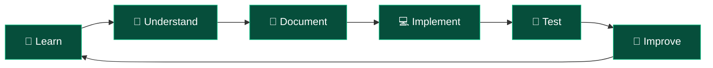

# ☕ Java Backend Journey

<div align="center">


<br/>


**A hands-on journey into Java Backend Development, database engineering and building real-world applications.**

</div>

---

## `$ whoami`

Welcome to my Java Backend Journey!

This repository documents my progress in understanding how backend applications work, how Java communicates with databases, and how different technologies come together to build reliable software systems.

It serves as my personal technical handbook, containing:

- Structured technical documentation.
- Practical Java implementations.
- Database connectivity examples.
- Architecture and workflow diagrams.
- Important concepts and interview preparation.
- Hands-on experiments and projects.

**The objective is not just to learn technologies, but to understand and implement them.**

---

## ⚙️ Technology Stack

<div align="center">

### Currently Exploring


### Exploring Next


</div>

---

## 🗺️ Learning Roadmap

| # | Technology / Concept | Status |
|:---:|---|:---:|
| 01 | Apache Maven | ✅ Completed |
| 02 | JDBC – Java Database Connectivity | ✅ Completed |
| 03 | Hibernate & ORM | 🔄 Next |
| 04 | Servlets & JSP | ⏳ Upcoming |
| 05 | Advanced Java | ⏳ Upcoming |
| 06 | Spring Framework | ⏳ Upcoming |
| 07 | Spring Boot | ⏳ Upcoming |
| 08 | REST API Development | ⏳ Upcoming |
| 09 | Spring Data JPA | ⏳ Upcoming |
| 10 | Spring Security | ⏳ Upcoming |
| 11 | Testing & Deployment | ⏳ Upcoming |
| 12 | Backend Projects | ⏳ Upcoming |

*The roadmap evolves as new concepts and practical implementations are explored.*

---

## 📚 Technical Documentation

Every topic is documented with explanations, architecture diagrams, examples, and interview questions.

| Topic | Documentation | Practical Code |
|---|---|---|
| Apache Maven | [Maven Notes](notes/01-maven.md) | [Maven Examples](code/maven/) |
| JDBC | [JDBC Notes](notes/02-jdbc.md) | [JDBC Implementation](code/jdbc/) |
| Hibernate | Upcoming | Upcoming |

### Documentation Standards

Each major topic focuses on:

- Fundamentals and core concepts.
- Why the technology is needed.
- Internal working and architecture.
- Important classes, interfaces and components.
- Code examples and practical implementation.
- Advantages, limitations and use cases.
- Common interview questions.
- Quick revision notes.

---

## 🏗️ Repository Architecture

```text
java-backend-journey/
│
├── README.md
│
├── notes/
│   ├── 01-maven.md
│   ├── 02-jdbc.md
│   └── ...
│
├── code/
│   ├── maven/
│   ├── jdbc/
│   │   ├── README.md
│   │   └── JdbcDemo.java
│   └── ...
│
└── progress.md
```

| Directory | Description |
|---|---|
| `notes/` | Detailed technical documentation |
| `code/` | Practical Java implementations |
| `progress.md` | Learning and implementation tracker |

---

## 🔄 Development Workflow

<div align="center">



</div>

My approach is simple:

**Understand the concept → Write the implementation → Test it → Document the learning → Improve it.**

---

## 📊 Current Progress

<details>
<summary><b>View completed milestones</b></summary>

### Milestone 01 — Maven

- [x] Introduction to Apache Maven
- [x] Understanding dependency management
- [x] Understanding Maven repositories
- [x] Maven fundamentals documentation

### Milestone 02 — JDBC

- [x] JDBC introduction
- [x] PostgreSQL setup
- [x] JDBC architecture
- [x] Database connectivity
- [x] Query execution
- [x] Fetching records
- [x] CRUD operations
- [x] Statement and PreparedStatement
- [x] Practical JDBC implementation

</details>

**Current Focus:** Hibernate & Object Relational Mapping (ORM).

See the [detailed progress tracker](progress.md).

---

## 🎯 What's Next?

- [ ] Understand Hibernate and ORM fundamentals.
- [ ] Explore entity mapping and database interaction.
- [ ] Understand how Hibernate simplifies JDBC operations.
- [ ] Explore the Spring ecosystem.
- [ ] Build independent backend applications.
- [ ] Develop and deploy production-oriented projects.

---

## 🤝 Connect

<div align="center">

<a href="https://github.com/YOUR_USERNAME">

</a>

<a href="https://www.linkedin.com/in/YOUR_LINKEDIN_USERNAME/">

</a>

<br/><br/>

**Building knowledge one concept and one implementation at a time.**


</div>