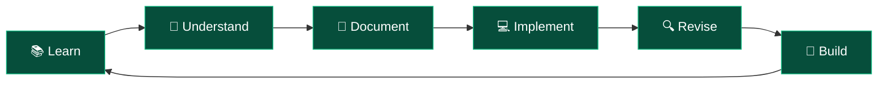

<!-- ================= HEADER ================= -->

<div align="center">


<br/>

<p>
  
  
  
</p>

<p>
  <b>A structured journey from Java fundamentals to building production-ready backend applications.</b>
</p>

</div>

---

## `$ whoami`

I'm documenting my journey of learning **Java Backend Development**, exploring how backend applications are designed, developed, connected to databases, and deployed.

This repository serves as my personal technical handbook — containing detailed notes, practical code implementations, concepts, experiments, and learning progress.

Rather than simply completing a course, my goal is to understand the engineering behind backend systems and develop the ability to build them independently.

### 🎯 The Mission

- Strengthen Java programming fundamentals.
- Understand backend architecture and application workflows.
- Learn database connectivity and data management.
- Explore the Spring ecosystem and Spring Boot.
- Build practical backend applications.
- Develop production-oriented engineering skills.

---

## ⚙️ Technology Stack

<div align="center">

### Currently Exploring


### Future Learning Path


</div>

<p align="center">
  <i>Technologies are added as I progress through the learning journey.</i>
</p>

---

## 📚 Learning Roadmap

My learning follows the sequence of my course and practical exploration rather than a rigid predefined syllabus.

| # | Topic | Status |
|:---:|---|:---:|
| 01 | Apache Maven | 🟡 In Progress |
| 02 | JDBC | 🔄 Currently Learning |
| 03 | Servlets & JSP | ⏳ Upcoming |
| 04 | Advanced Java | ⏳ Upcoming |
| 05 | Spring Framework | ⏳ Upcoming |
| 06 | Spring Boot | ⏳ Upcoming |
| 07 | REST API Development | ⏳ Upcoming |
| 08 | Hibernate & Spring Data JPA | ⏳ Upcoming |
| 09 | Spring Security | ⏳ Upcoming |
| 10 | Testing & Deployment | ⏳ Upcoming |
| 11 | Backend Projects | ⏳ Upcoming |

*The roadmap is flexible and will evolve with the course and additional practical learning.*

---

## 📖 Documentation & Learning Notes

Every completed topic is documented with explanations, examples, and practical implementations wherever applicable.

| Topic | Documentation | Code |
|---|---|---|
| Maven | [Introduction](notes/01-maven.md) | [Examples](code/maven/) |
| JDBC | Coming Soon | [Examples](code/jdbc/) |

### 📝 Documentation Includes

- Conceptual explanations and fundamentals
- Why a technology or concept is needed
- Internal working and architecture
- Important terminology
- Java, SQL and configuration examples
- Practical implementations
- Advantages, limitations and use cases
- Common interview questions
- Quick revision notes

---

## 📂 Repository Structure

```text
java-backend-journey/
│
├── README.md
│
├── notes/
│   ├── 01-maven.md
│   ├── 02-jdbc.md
│   └── ...
│
├── code/
│   ├── maven/
│   ├── jdbc/
│   └── ...
│
└── progress.md
```

**Repository organization:**

| Directory | Purpose |
|---|---|
| `notes/` | Detailed technical documentation |
| `code/` | Practical Java implementations |
| `progress.md` | Learning progress and completed topics |

---

## 🔄 My Learning Workflow

<div align="center">



</div>

I believe that understanding a concept is only the beginning. The real learning happens when I can implement it, debug it, explain it, and use it to solve actual problems.

---

## 📈 Learning Progress

**Current focus:** Java Database Connectivity (JDBC)

**Completed:** Maven Introduction

**Learning source:** Telusko — Udemy Java Course

For detailed updates, check the [Learning Progress Tracker](progress.md).

---

## 🌱 What's Next?

- [ ] Complete JDBC fundamentals.
- [ ] Perform database operations using Java.
- [ ] Understand how Java applications communicate with databases.
- [ ] Explore the Spring ecosystem.
- [ ] Develop backend applications using Spring Boot.
- [ ] Build and deploy independent backend projects.

---

## 🤝 Connect & Follow the Journey

<div align="center">

<a href="https://github.com/Aradhy2005">
  
</a>

<a href="https://www.linkedin.com/in/aradhy-bajpai-897241283/">
  
</a>

<br/><br/>

**Learning in public. Building with purpose. Growing one concept at a time.**


</div>