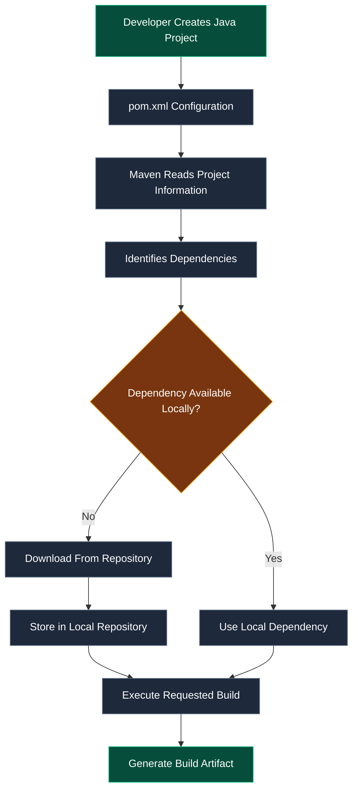
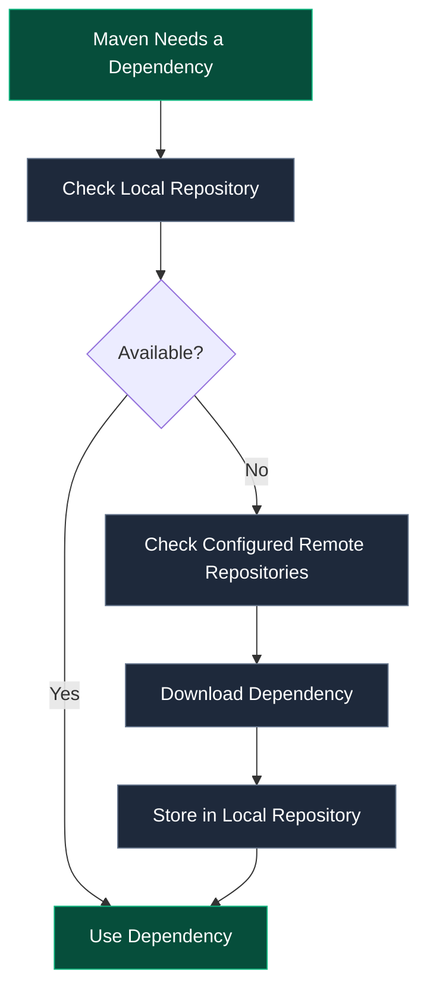

# 01 | Apache Maven

<div align="center">


### Understanding Build Automation & Dependency Management

*The foundation of managing and building Java applications efficiently.*

</div>

---

## 01. Introduction — What is Maven?

**Apache Maven** is a build automation and project management tool primarily used for Java-based applications.

It simplifies the software development process by automating repetitive tasks such as:

- Compiling source code.
- Managing external dependencies.
- Running test cases.
- Packaging applications.
- Maintaining a standardized project structure.

> **In simple terms:** Maven helps developers manage project dependencies and automate the process of building Java applications.

## 02. Why Do We Need Maven?

Imagine developing a Java application that requires multiple external libraries.

For example:
- MySQL Connector
- Spring Framework
- Hibernate
- JUnit

### Without Maven

Developers have to:

1. Search and download required JAR files manually.
2. Add JAR files to the project's classpath.
3. Manage different library versions.
4. Resolve dependencies between libraries.
5. Update libraries manually whenever required.

This becomes increasingly difficult as the project grows.

### With Maven

Maven automates dependency management and simplifies the build process.

| Without Maven | With Maven |
|---|---|
| Manual JAR downloads | Automatic dependency downloads |
| Manual version management | Centralized dependency configuration |
| Manual classpath configuration | Dependency resolution |
| Repetitive build operations | Automated build process |
| More maintenance | Standardized project management |

**Key takeaway:** Maven reduces manual work and makes Java project management more efficient.

---

## 03. Key Features of Maven

| Feature | Description |
|---|---|
| Dependency Management | Automatically manages external libraries. |
| Build Automation | Automates compilation, testing and packaging. |
| Standard Project Structure | Provides a predefined directory structure. |
| Version Management | Allows developers to specify dependency versions. |
| Plugin Support | Extends build functionality through plugins. |
| Project Management | Maintains project information and configuration. |

---

## 04. How Does Maven Work?

Maven primarily works using a configuration file called `pom.xml`.

**POM stands for Project Object Model.**

It contains information about the project, its dependencies, plugins and build configuration.

### Maven Workflow



### Understanding the Workflow

1. The developer creates a Java project.
2. Maven reads the `pom.xml` file.
3. It identifies the project's dependencies and build configuration.
4. Maven checks whether required dependencies are available locally.
5. If a dependency is unavailable, Maven retrieves it from a configured remote repository.
6. Maven executes the requested build operations.
7. The final output, such as a JAR or WAR file, can be generated depending on the project configuration.

---

## 05. Maven Repositories

A **repository** is a storage location where Maven retrieves dependencies and stores build artifacts.

Maven uses three main types of repositories.

### A. Local Repository

- Exists on the developer's local machine.
- Stores downloaded dependencies.
- Helps avoid downloading the same dependency repeatedly.

Default location on Windows:

```text
C:\Users\USERNAME\.m2\repository
```

### B. Central Repository

- A publicly available repository maintained by the Maven ecosystem.
- Contains a large collection of Java libraries.
- Maven can download dependencies from it when required.

Official website: https://central.sonatype.com/

### C. Remote Repository

- A repository hosted on a remote server.
- Organizations and development teams can maintain their own repositories.
- Can contain private or organization-specific dependencies.

### Repository Workflow



**Remember:** Maven checks the local repository first. If the required dependency is not available, it can retrieve it from the configured remote repositories.

---

## 06. Important Maven Terminologies

| Terminology | Meaning |
|---|---|
| Maven | Build automation and project management tool. |
| POM | Project Object Model. |
| pom.xml | Main Maven configuration file. |
| Dependency | External library required by a project. |
| Repository | Storage location for dependencies and artifacts. |
| Plugin | Component that extends Maven's build functionality. |
| Group ID | Identifies the organization or project group. |
| Artifact ID | Identifies a particular project or library. |
| Version | Identifies a particular release of an artifact. |
| JAR | Java Archive containing compiled classes and resources. |

### Understanding Dependency Coordinates

A Maven dependency is generally identified by three important values:

```text
groupId : artifactId : version
```

Example:

```text
org.springframework : spring-core : 6.2.0
```

These values help Maven identify a specific library and its version.

---

## 07. Advantages of Maven

1. **Simplified Dependency Management:** Automatically downloads and manages required libraries.
2. **Build Automation:** Reduces repetitive manual build operations.
3. **Standardization:** Provides a consistent project structure.
4. **Version Control:** Makes dependency version management easier.
5. **Collaboration:** Helps developers work with consistent project configurations.
6. **Extensibility:** Plugins provide additional build capabilities.

---

## 08. Interview Preparation

### Q1. What is Apache Maven?

Apache Maven is a build automation and project management tool used primarily for Java applications. It manages dependencies and automates compilation, testing and packaging.

### Q2. Why do we use Maven?

Maven simplifies dependency management, automates build operations, and provides a standardized project structure.

### Q3. What is POM?

POM stands for Project Object Model. It describes project information, dependencies, plugins and build configuration.

### Q4. What is the purpose of pom.xml?

It is the main Maven configuration file that defines project metadata, dependencies, plugins and build settings.

### Q5. What are Maven repositories?

Repositories are storage locations from which Maven retrieves dependencies and where artifacts can be stored.

### Q6. What are the three types of Maven repositories?

- Local Repository
- Central Repository
- Remote Repository

### Q7. Is Maven a programming language or framework?

No. Maven is a build automation and project management tool.

### Q8. What is dependency management?

Dependency management is the process of handling external libraries required by an application, including their versions and availability.

### Q9. What is a Maven plugin?

A plugin extends Maven's functionality by providing specific tasks during the build process.

---

## 09. Quick Revision Sheet

| Question | Answer |
|---|---|
| What is Maven? | Build automation and project management tool |
| Main configuration file? | `pom.xml` |
| POM full form? | Project Object Model |
| Dependency means? | External library |
| Where are dependencies stored locally? | `.m2/repository` |
| Public dependency repository? | Maven Central |
| What extends Maven functionality? | Plugins |
| What does Maven automate? | Build operations |

### Key Points to Remember

- Maven is not a Java framework.
- Maven primarily uses XML for project configuration.
- `pom.xml` is the central configuration file.
- Maven manages project dependencies.
- Maven retrieves libraries from repositories.
- Maven supports build automation through plugins and lifecycle phases.

---

## 10. Further Learning

The following topics will be explored separately as I progress through the course:

- [ ] Maven Installation and Configuration
- [ ] Creating a Maven Project
- [ ] Maven Project Directory Structure
- [ ] Understanding `pom.xml` in Detail
- [ ] Maven Build Lifecycle
- [ ] Maven Dependency Scopes
- [ ] Maven Plugins
- [ ] Important Maven Commands

---

<div align="center">

### LEARN → UNDERSTAND → IMPLEMENT → DOCUMENT

**Topic:** Apache Maven Introduction

**Learning Source:** Telusko — Udemy Java Course

**Documentation Status:** Introduction Completed

*One concept at a time. One step closer to becoming a better backend engineer.*

</div>