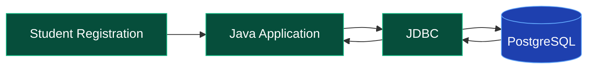
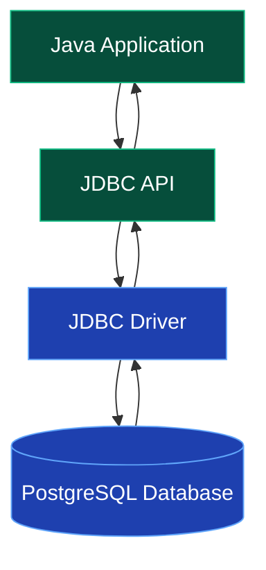
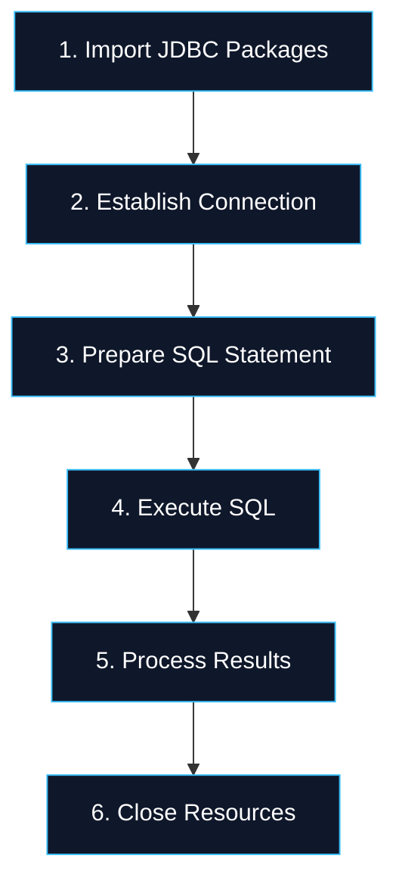
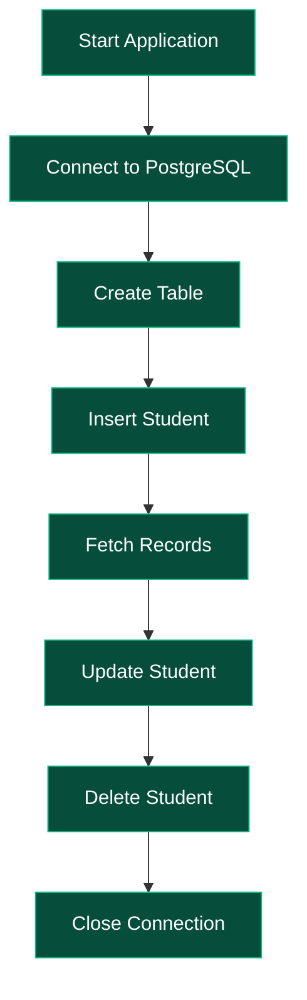

# 02 — JDBC | Java Database Connectivity

<div align="center">


<br/>


### A Beginner-Friendly Guide to Java Database Connectivity

*From your first database connection to executing SQL queries and performing CRUD operations.*

</div>

---

## 🧭 Quick Navigation

- [What is JDBC?](#-1-what-is-jdbc)
- [Why Do We Need JDBC?](#-2-why-do-we-need-jdbc)
- [JDBC Architecture](#-3-jdbc-architecture)
- [PostgreSQL Setup](#-4-postgresql-setup)
- [JDBC Driver](#-5-what-is-a-jdbc-driver)
- [Steps to Connect Java with a Database](#-6-steps-to-connect-java-with-a-database)
- [Executing SQL Queries](#-7-executing-sql-queries)
- [ResultSet](#-8-understanding-resultset)
- [CRUD Operations](#-9-crud-operations)
- [Statement vs PreparedStatement](#-10-statement-vs-preparedstatement)
- [Practical Implementation](#-11-practical-implementation)
- [Interview Questions](#-12-interview-questions)
- [Quick Revision](#-13-quick-revision)

---

## 📌 1. What is JDBC?

**JDBC stands for Java Database Connectivity.**

It is a Java API that allows Java applications to communicate with relational databases such as PostgreSQL, MySQL and Oracle Database.

Imagine building a Java application for managing students.

You want to:

- Add a new student.
- View all students.
- Update student details.
- Delete a student.

But where will the data be stored permanently?

In a database!

**JDBC provides the standard Java API for communicating with that database.**

> 💡 **Remember:** JDBC is not a database. It is a Java API used to connect and interact with databases.

---

## 🤔 2. Why Do We Need JDBC?

Without a database, information stored only in ordinary Java variables disappears when the application stops.

A database allows information to be stored persistently.

But Java needs a way to communicate with that database.

That's where JDBC comes in.

### Real-World Example

Consider a student management system.



When a student registers:

1. The Java application receives the student's details.
2. JDBC is used to execute an SQL INSERT operation.
3. PostgreSQL stores the data.
4. The application receives the operation result.

---

## 🏗️ 3. JDBC Architecture

JDBC provides a common programming interface for interacting with different relational databases.

### How JDBC Works Internally



### Main Components

| Component | Simple Explanation |
|---|---|
| Java Application | The program that needs to work with data. |
| JDBC API | Standard Java interfaces for database operations. |
| JDBC Driver | Database-specific software that handles communication. |
| PostgreSQL | The database where information is stored. |

### Important JDBC Classes and Interfaces

| Component | Purpose |
|---|---|
| `DriverManager` | Helps establish a database connection. |
| `Connection` | Represents a connection to the database. |
| `Statement` | Executes SQL statements. |
| `PreparedStatement` | Executes SQL with safely bound parameter values. |
| `ResultSet` | Allows Java to read records returned by a query. |

---

## 🐘 4. PostgreSQL Setup

For this guide, we'll use PostgreSQL.

PostgreSQL is a free, open-source relational database management system.

### Basic Setup

1. Install PostgreSQL.
2. Start the PostgreSQL server.
3. Create a database.
4. Configure your database credentials.
5. Add the PostgreSQL JDBC driver to your Java project.

Create a database:

```sql
CREATE DATABASE jdbc_demo;
```

### JDBC Connection URL

```text
jdbc:postgresql://localhost:5432/jdbc_demo
```

| Part | Meaning |
|---|---|
| `jdbc` | JDBC URL prefix |
| `postgresql` | Database type |
| `localhost` | Database server |
| `5432` | Default PostgreSQL port |
| `jdbc_demo` | Database name |

---

## 🔌 5. What is a JDBC Driver?

A JDBC driver is a software component that allows Java to communicate with a specific database system.

Different database systems use different JDBC drivers.

For example:

| Database | Driver |
|---|---|
| PostgreSQL | PostgreSQL JDBC Driver |
| MySQL | MySQL Connector/J |
| Oracle | Oracle JDBC Driver |

### Adding the PostgreSQL Driver

If you're using Maven, add this dependency to `pom.xml`:

```xml
<dependency>
    <groupId>org.postgresql</groupId>
    <artifactId>postgresql</artifactId>
    <version>42.7.5</version>
</dependency>
```

This is an example driver version; use a compatible supported release for your project.

Maven will download and configure the dependency for your project.

> 💡 Modern JDBC drivers generally register themselves automatically. Explicitly calling `Class.forName()` is usually unnecessary.

---

## 🔄 6. Steps to Connect Java with a Database

Let's understand the complete JDBC workflow.



### Step 1 — Import JDBC Packages

```java
import java.sql.*;
```

### Step 2 — Establish Connection

```java
String url = "jdbc:postgresql://localhost:5432/jdbc_demo";
String user = "postgres";
String password = System.getenv("DB_PASSWORD");

Connection con = DriverManager.getConnection(
    url, user, password
);
```

### Step 3 — Prepare an SQL Statement

```java
String sql = "SELECT * FROM students";

PreparedStatement ps = con.prepareStatement(sql);
```

### Step 4 — Execute the Query

```java
ResultSet rs = ps.executeQuery();
```

### Step 5 — Process the Results

```java
while (rs.next()) {
    System.out.println(rs.getString("name"));
}
```

### Step 6 — Close Resources

JDBC resources should be closed after use.

The recommended approach is **try-with-resources**, which automatically closes resources even when an exception occurs.

---

## ⚡ 7. Executing SQL Queries

JDBC provides different methods to execute SQL statements.

| Method | Used For | Returns |
|---|---|---|
| `executeQuery()` | Queries returning rows, typically SELECT | `ResultSet` |
| `executeUpdate()` | INSERT, UPDATE, DELETE and applicable DDL | `int` |
| `execute()` | General SQL execution | `boolean` |

### executeQuery()

```java
ResultSet rs = ps.executeQuery();
```

Used when the SQL statement returns a result set.

### executeUpdate()

```java
int rows = ps.executeUpdate();
```

Returns the affected-row count for applicable data modification statements.

### execute()

```java
boolean hasResultSet = ps.execute();
```

Returns `true` if the first result is a `ResultSet`.

---

## 📊 8. Understanding ResultSet

`ResultSet` represents the data returned by a query.

Imagine the following database table:

| id | name | age |
|---|---|---|
| 1 | Arjun | 21 |
| 2 | Priya | 22 |
| 3 | Rahul | 20 |

When Java executes:

```sql
SELECT * FROM students;
```

The database returns matching records.

### ResultSet Cursor


Example:

```java
while (rs.next()) {
    int id = rs.getInt("id");
    String name = rs.getString("name");

    System.out.println(id + " - " + name);
}
```

`rs.next()` moves the cursor to the next record and returns `false` when no more records are available.

---

## 🧩 9. CRUD Operations

CRUD represents four fundamental database operations.

<div align="center">

| Operation | SQL Command | Meaning |
|---|---|---|
| 🟢 CREATE | INSERT | Add new data |
| 🔵 READ | SELECT | Retrieve data |
| 🟡 UPDATE | UPDATE | Modify data |
| 🔴 DELETE | DELETE | Remove data |

</div>

### CREATE

```sql
INSERT INTO students (name, age)
VALUES ('Arjun', 21);
```

### READ

```sql
SELECT * FROM students;
```

### UPDATE

```sql
UPDATE students
SET age = 22
WHERE id = 1;
```

### DELETE

```sql
DELETE FROM students
WHERE id = 1;
```

> ⚠️ Always check the WHERE condition when updating or deleting specific records.

---

## 🔐 10. Statement vs PreparedStatement

This is one of the most important JDBC concepts.

### Statement

`Statement` executes SQL statements directly.

```java
Statement stmt = con.createStatement();

ResultSet rs = stmt.executeQuery(
    "SELECT * FROM students"
);
```

The problem arises when untrusted input is concatenated into SQL strings.

### Unsafe Example

```java
String sql =
    "SELECT * FROM students WHERE name = '" + userInput + "'";
```

A malicious input may modify the SQL query.

This is called **SQL Injection**.

### PreparedStatement

`PreparedStatement` supports parameterized SQL queries.

```java
String sql =
    "SELECT * FROM students WHERE name = ?";

PreparedStatement ps = con.prepareStatement(sql);

ps.setString(1, "Arjun");

ResultSet rs = ps.executeQuery();
```

The `?` acts as a placeholder for a value.

`setString(1, "Arjun")` assigns the first parameter.

### Comparison

| Statement | PreparedStatement |
|---|---|
| Executes SQL directly | Supports parameterized SQL |
| Dynamic values may require concatenation | Uses placeholders |
| Unsafe concatenation can lead to SQL injection | Bound values help prevent SQL injection |
| Useful for simple static queries | Preferred for dynamic values |

### Why PreparedStatement Is Preferred

- Helps prevent SQL injection for bound values.
- Avoids manual SQL string concatenation.
- Improves readability.
- Supports repeated execution with different parameters.

> **Important:** Parameter placeholders are for values, not SQL identifiers such as table names or column names.

---

## 💻 11. Practical Implementation

The JDBC implementation demonstrates how to:

- Connect Java with PostgreSQL.
- Create a database table.
- Insert student records.
- Retrieve records.
- Update existing records.
- Delete records.
- Use PreparedStatement.
- Close database resources safely.

### Explore the Code

**[View JdbcDemo.java](../code/jdbc/JdbcDemo.java)**

**[View JDBC Implementation Guide](../code/jdbc/README.md)**

### Application Flow



---

## 🎯 12. Interview Questions

<details>
<summary><b>Q1. What is JDBC?</b></summary>

JDBC is a Java API that enables Java applications to communicate with relational databases and execute SQL operations.

</details>

<details>
<summary><b>Q2. What is the role of DriverManager?</b></summary>

DriverManager manages JDBC drivers and provides methods for establishing database connections.

</details>

<details>
<summary><b>Q3. What is a JDBC driver?</b></summary>

A JDBC driver is database-specific software that enables communication between a Java application and a database.

</details>

<details>
<summary><b>Q4. What is Connection?</b></summary>

Connection represents an active database connection and provides methods for creating statements and managing transactions.

</details>

<details>
<summary><b>Q5. What is ResultSet?</b></summary>

ResultSet provides access to rows returned by an SQL query.

</details>

<details>
<summary><b>Q6. What is the difference between Statement and PreparedStatement?</b></summary>

Statement executes SQL directly, while PreparedStatement supports parameterized queries with separately bound values.

</details>

<details>
<summary><b>Q7. What is SQL Injection?</b></summary>

SQL Injection is a vulnerability in which malicious input changes the intended structure or behavior of an SQL query.

</details>

<details>
<summary><b>Q8. Why is PreparedStatement safer?</b></summary>

It separates SQL structure from bound parameter values, preventing those values from being interpreted as SQL syntax.

</details>

<details>
<summary><b>Q9. What is the difference between executeQuery() and executeUpdate()?</b></summary>

executeQuery() returns a ResultSet, whereas executeUpdate() returns an integer representing the affected-row count for applicable operations.

</details>

<details>
<summary><b>Q10. What is the default PostgreSQL port?</b></summary>

The default PostgreSQL port is 5432.

</details>

---

## 📝 13. Quick Revision

| Concept | Remember |
|---|---|
| JDBC | Java Database Connectivity |
| DriverManager | Establishes database connections |
| Connection | Represents a database connection |
| Statement | Executes SQL statements |
| PreparedStatement | Supports parameterized queries |
| ResultSet | Reads query results |
| executeQuery() | Returns ResultSet |
| executeUpdate() | Returns integer row count |
| CRUD | Create, Read, Update, Delete |
| PostgreSQL Port | 5432 |
| SQL Injection | Query manipulation through unsafe input |
| try-with-resources | Automatically closes JDBC resources |

---

## 🚀 What's Next?

### Hibernate & Object Relational Mapping

JDBC provides direct control over database operations, but it often requires writing SQL and manually converting database rows into Java objects.

Hibernate introduces Object Relational Mapping (ORM), which helps map Java objects to relational database tables.

**Next Topic: Hibernate**

---

<div align="center">

### LEARN → UNDERSTAND → CONNECT → BUILD


**Part of the Java Backend Journey**


</div>