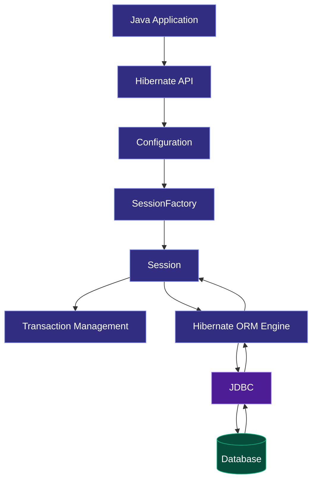
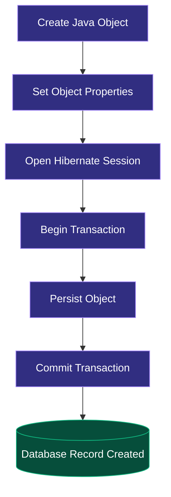
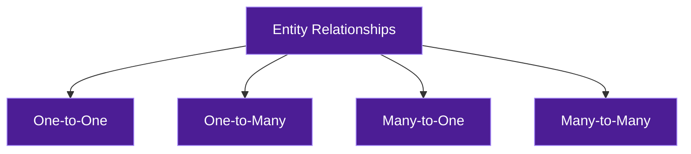
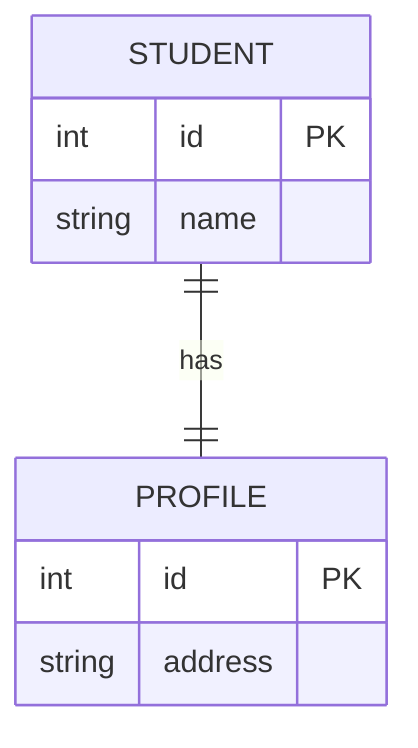
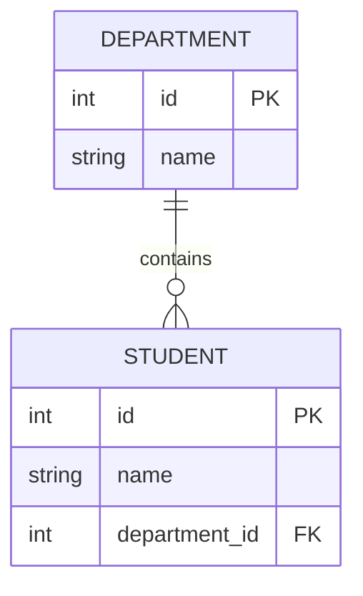
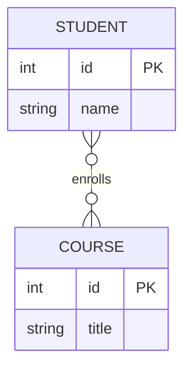
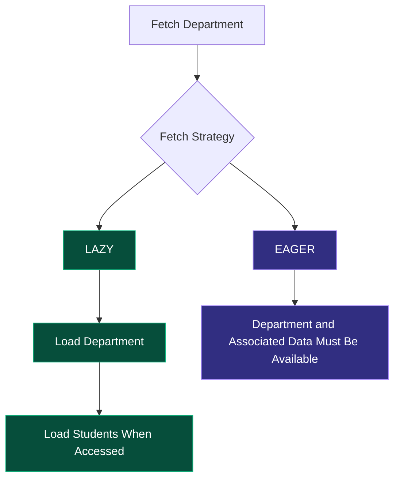
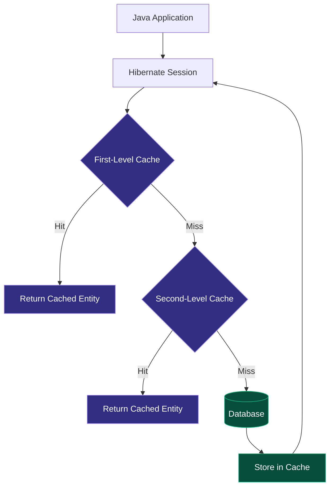
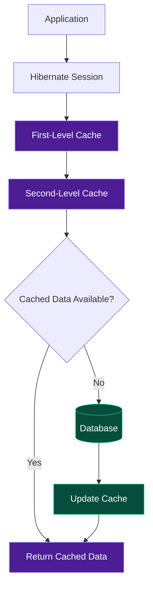
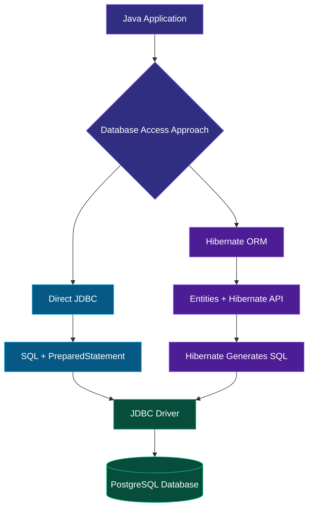

# 03 — Hibernate | Java ORM Framework

<div align="center">


<br/>


### A Beginner-Friendly Guide to Hibernate and ORM

*Understand how Hibernate simplifies database operations by mapping Java objects to relational database tables.*

</div>

---

## 🧭 Table of Contents

1. [What is Hibernate?](#-1-what-is-hibernate)
2. [Why Do We Need Hibernate?](#-2-why-do-we-need-hibernate)
3. [Hibernate Architecture](#-3-hibernate-architecture)
4. [Hibernate Project Setup](#-4-hibernate-project-setup)
5. [Saving Data in Hibernate](#-5-saving-data-in-hibernate)
6. [Hibernate Configuration](#-6-hibernate-configuration)
7. [Refactoring Hibernate Code](#-7-refactoring-hibernate-code)
8. [Fetching Data](#-8-fetching-data)
9. [Updating and Deleting Objects](#-9-updating-and-deleting-objects)
10. [Table and Column Mapping](#-10-changing-table-and-column-names)
11. [Embeddable Objects](#-11-embeddable-objects)
12. [Entity Relationships](#-12-mapping-relationships)
13. [Eager vs Lazy Fetching](#-13-eager-vs-lazy-fetching)
14. [Hibernate Caching](#-14-hibernate-caching)
15. [HQL Introduction](#-15-hql-introduction)
16. [Fetching Data Using HQL](#-16-fetching-data-using-hql)
17. [Filtering and Specific Properties](#-17-filtering-and-fetching-specific-properties)
18. [get() vs load()](#-18-get-vs-load)
19. [Second-Level Cache Using Ehcache](#-19-second-level-cache-using-ehcache)
20. [Interview Questions](#-20-interview-questions)
21. [Quick Revision](#-21-quick-revision)

---

# 🟣 01. What is Hibernate?

**Hibernate is an Object Relational Mapping (ORM) framework for Java.**

Before understanding Hibernate, let's understand ORM.

### What is ORM?

ORM stands for **Object Relational Mapping**.

In Java, we work with objects and classes.

In relational databases, we work with tables and rows.

ORM provides a way to map these two different structures.

<details>
<summary><b>Understand with a simple example</b></summary>

Suppose we have a Java class:

```java
class Student {
    int id;
    String name;
    int age;
}
```

And a database table:

| id | name | age |
|---|---|---|
| 1 | Arjun | 21 |
| 2 | Rahul | 22 |

ORM maps:

- Java class → Database table
- Java object → Database row
- Java field → Database column

Hibernate performs this mapping and manages database interactions.

</details>

### What Does Hibernate Do?

Hibernate allows developers to:

- Save Java objects into databases.
- Retrieve database records as Java objects.
- Update existing objects.
- Delete records.
- Map relationships between entities.
- Manage database transactions.
- Reduce repetitive JDBC code.

<badge color="success">Remember</badge>

Hibernate is an ORM framework that works on top of JDBC. It does not eliminate JDBC; it abstracts many of its repetitive operations.

---

# 🤔 02. Why Do We Need Hibernate?

Let's first understand the problem with traditional JDBC.

### Working with JDBC

When using JDBC, developers generally need to:

1. Establish a database connection.
2. Write SQL queries.
3. Create PreparedStatement objects.
4. Execute SQL statements.
5. Fetch ResultSet records.
6. Convert database rows into Java objects.
7. Manage resources and transactions.

For example:

```java
String sql = "INSERT INTO students(name, age) VALUES (?, ?)";

PreparedStatement ps = con.prepareStatement(sql);

ps.setString(1, "Arjun");
ps.setInt(2, 21);

ps.executeUpdate();
```

You also need to handle connections, statements and transactions.

### How Hibernate Simplifies This

With Hibernate, you can work with Java objects directly.

```java
Student student = new Student();

student.setName("Arjun");
student.setAge(21);

session.persist(student);
```

Hibernate manages the SQL generation and database interaction according to its configuration and mapping.

### JDBC vs Hibernate

| JDBC | Hibernate |
|---|---|
| Java Database Connectivity API | ORM framework |
| Works directly with SQL | Works primarily with Java objects |
| Manual object mapping | Automatic ORM mapping |
| More repetitive code | Reduces boilerplate code |
| Developers manage SQL execution | Hibernate manages SQL generation |
| Direct control over SQL | Provides an abstraction over SQL |
| Manual resource handling | Provides resource-management APIs |

### When Should We Use Hibernate?

Hibernate is useful when:

- Building database-driven Java applications.
- Working with multiple related entities.
- Reducing repetitive database code.
- Managing object relationships.
- Developing maintainable backend applications.

However, JDBC is still useful when you need very specific SQL control, database-specific features or performance-sensitive queries.

---

# 🏗️ 03. Hibernate Architecture

Let's understand how Hibernate communicates with a database.

### Overall Architecture



### Important Hibernate Components

| Component | Responsibility |
|---|---|
| Configuration | Reads Hibernate configuration and mappings. |
| SessionFactory | Creates Session objects and is generally shared across the application. |
| Session | Represents a unit of interaction with the database. |
| Transaction | Manages database transaction boundaries. |
| Query | Executes HQL, JPQL or native SQL queries. |
| Entity | Java class mapped to a database table. |

### Understanding the Main Components

**1. Configuration**

Loads database settings and Hibernate mapping information.

**2. SessionFactory**

Creates Session objects.

It is generally created once per database configuration and reused throughout the application.

**3. Session**

Provides methods to save, retrieve, update and delete objects.

A Session is usually short-lived and should not be shared between concurrent threads.

**4. Transaction**

Ensures that database operations are committed or rolled back as a unit.

**5. Entity**

A Java class representing a database entity.

---

# ⚙️ 04. Hibernate Project Setup

Let's understand how to create a Hibernate project using Maven.

### Step 1: Create a Maven Project

Create a standard Maven Java project.

```text
HibernateProject/
│
├── pom.xml
│
└── src/
    └── main/
        └── java/
            └── com/example/
```

### Step 2: Add Hibernate Dependency

Add Hibernate ORM to your `pom.xml`.

```xml
<dependency>
    <groupId>org.hibernate.orm</groupId>
    <artifactId>hibernate-core</artifactId>
    <version>${hibernate.version}</version>
</dependency>
```

Define a compatible Hibernate version in your Maven properties.

For PostgreSQL, also add:

```xml
<dependency>
    <groupId>org.postgresql</groupId>
    <artifactId>postgresql</artifactId>
    <version>${postgresql.version}</version>
</dependency>
```

Maven downloads the required libraries.

### Step 3: Create a Database

```sql
CREATE DATABASE hibernate_demo;
```

### Step 4: Create an Entity Class

```java
import jakarta.persistence.Entity;
import jakarta.persistence.Id;

@Entity
public class Student {

    @Id
    private int id;

    private String name;

    private int age;

    public Student() {
    }

    // Getters and setters
}
```

### Understanding the Annotations

| Annotation | Purpose |
|---|---|
| `@Entity` | Marks a class as a persistent entity. |
| `@Id` | Defines the primary key. |
| `@Column` | Configures a database column. |
| `@Table` | Configures the database table name. |

Hibernate uses these annotations to understand how Java objects should be mapped to database tables.

---

# 💾 05. Saving Data in Hibernate

One of the fundamental Hibernate operations is saving an object into the database.

### How Does It Work?



### Example

```java
Student student = new Student();

student.setId(1);
student.setName("Arjun");
student.setAge(21);

session.persist(student);
```

`persist()` makes the new entity persistent within the current Hibernate Session. The INSERT may be executed later, often at flush or transaction commit.

### Why Can Saving Data Fail?

Simply creating an object does not save it to the database.

Common reasons for failure include:

- Missing transaction.
- Incorrect database credentials.
- Database server not running.
- Missing primary key.
- Incorrect entity mapping.
- Missing database driver.
- Database constraint violations.

### Correct Transaction Flow

```java
Transaction tx = null;

try {
    tx = session.beginTransaction();

    session.persist(student);

    tx.commit();

} catch (Exception e) {

    if (tx != null) {
        tx.rollback();
    }

    throw e;
}
```

**Important:** A transaction must be committed for the database changes to be finalized. If an error occurs, rollback helps undo uncommitted changes.

---

# 🛠️ 06. Hibernate Configuration

Hibernate needs database configuration to establish connections and understand how it should interact with the database.

A common approach is using `hibernate.cfg.xml`.

### Example Configuration

```xml
<?xml version="1.0" encoding="UTF-8"?>

<!DOCTYPE hibernate-configuration PUBLIC
    "-//Hibernate/Hibernate Configuration DTD 3.0//EN"
    "https://hibernate.org/dtd/hibernate-configuration-3.0.dtd">

<hibernate-configuration>
    <session-factory>

        <property name="hibernate.connection.driver_class">
            org.postgresql.Driver
        </property>

        <property name="hibernate.connection.url">
            jdbc:postgresql://localhost:5432/hibernate_demo
        </property>

        <property name="hibernate.connection.username">
            postgres
        </property>

        <property name="hibernate.connection.password">
            YOUR_PASSWORD
        </property>

        <property name="hibernate.dialect">
            org.hibernate.dialect.PostgreSQLDialect
        </property>

        <property name="hibernate.show_sql">true</property>

        <property name="hibernate.format_sql">true</property>

        <property name="hibernate.hbm2ddl.auto">update</property>

        <mapping class="com.example.Student"/>

    </session-factory>
</hibernate-configuration>
```

### Important Configuration Properties

| Property | Purpose |
|---|---|
| `hibernate.connection.url` | Database URL |
| `hibernate.connection.username` | Database username |
| `hibernate.connection.password` | Database password |
| `hibernate.dialect` | SQL dialect configuration |
| `hibernate.show_sql` | Displays generated SQL |
| `hibernate.format_sql` | Formats SQL output |
| `hibernate.hbm2ddl.auto` | Controls schema generation behavior |

### Understanding hbm2ddl.auto

| Value | Meaning |
|---|---|
| `create` | Creates the schema, potentially dropping existing tables. |
| `update` | Attempts to update the schema. |
| `validate` | Checks whether the schema matches the mappings. |
| `create-drop` | Creates the schema and drops it when the SessionFactory closes. |
| `none` | Does not perform automatic schema generation. |

<badge color="warning">Important</badge>

`update` is useful for learning and development, but automatic schema updates should not be treated as a production database migration strategy.

Never expose database passwords in a public GitHub repository. Use environment variables or secure configuration.

---

# 🧹 07. Refactoring Hibernate Code

As applications grow, writing configuration and SessionFactory initialization repeatedly makes code difficult to maintain.

We can centralize Hibernate configuration.

### Without Refactoring

The same configuration logic may be repeated across multiple classes.

### After Refactoring

Create a reusable utility class.

```java
public class HibernateUtil {

    private static final SessionFactory FACTORY =
            new Configuration()
                    .configure()
                    .buildSessionFactory();

    public static SessionFactory getSessionFactory() {
        return FACTORY;
    }
}
```

Now use it wherever required:

```java
Session session =
        HibernateUtil.getSessionFactory().openSession();
```

### Why Is This Better?

- Avoids repeated configuration.
- Centralizes SessionFactory creation.
- Improves maintainability.
- Makes the application structure cleaner.

The SessionFactory should be closed during application shutdown.

---

# 🔍 08. Fetching Data

Hibernate allows us to retrieve database records as Java objects.

### Example

```java
Student student = session.get(Student.class, 1);
```

This retrieves the Student entity whose primary key is 1.

If the record exists, Hibernate returns the corresponding Java object.

If it doesn't exist, `get()` returns `null`.

### Fetching Multiple Records

Hibernate also supports retrieving multiple entities using query APIs.

```java
List<Student> students = session
        .createQuery("FROM Student", Student.class)
        .getResultList();
```

Here:

- `FROM Student` refers to the Java entity name.
- `getResultList()` returns a list of matching objects.

---

# ✏️ 09. Updating and Deleting Objects

Hibernate supports updating and deleting persistent entities.

### Updating an Object

```java
Transaction tx = session.beginTransaction();

Student student = session.get(Student.class, 1);

if (student != null) {
    student.setAge(22);
}

tx.commit();
```

Hibernate tracks changes to managed entities.

When the Session is flushed, Hibernate detects the changes and generates the required SQL UPDATE.

This is known as **dirty checking**.

### Deleting an Object

```java
Transaction tx = session.beginTransaction();

Student student = session.get(Student.class, 1);

if (student != null) {
    session.remove(student);
}

tx.commit();
```

`remove()` marks the managed entity for deletion.

### Operation Comparison

| Operation | Hibernate Method |
|---|---|
| Insert | `persist()` |
| Retrieve | `get()` |
| Update | Modify a managed object |
| Delete | `remove()` |

---

# 🗂️ 10. Changing Table and Column Names

By default, Hibernate derives database table and column names from entity classes and fields, subject to its naming strategy.

We can customize them using annotations.

### @Table

```java
@Entity
@Table(name = "student_details")
public class Student {
    
    @Id
    private int id;

    private String name;
}
```

The class maps to the `student_details` table.

### @Column

```java
@Entity
@Table(name = "student_details")
public class Student {

    @Id
    private int id;

    @Column(name = "student_name")
    private String name;
}
```

The `name` field maps to the `student_name` column.

### Useful Column Properties

```java
@Column(
    name = "student_email",
    nullable = false,
    unique = true,
    length = 150
)
private String email;
```

| Property | Purpose |
|---|---|
| `name` | Database column name |
| `nullable` | Controls whether NULL is permitted |
| `unique` | Declares a uniqueness constraint |
| `length` | Specifies string column length |

---

# 📦 11. Embeddable Objects

Sometimes an entity contains information that logically belongs together.

For example, a student has an address.

Instead of keeping every address field directly inside the Student class, we can create a separate reusable Java class.

This is where `@Embeddable` and `@Embedded` are useful.

### Address Class

```java
import jakarta.persistence.Embeddable;

@Embeddable
public class Address {

    private String city;

    private String state;

    private String country;

    // Getters and setters
}
```

### Student Class

```java
import jakarta.persistence.*;

@Entity
public class Student {

    @Id
    private int id;

    private String name;

    @Embedded
    private Address address;

    // Getters and setters
}
```

### How Is It Stored?

An embedded object generally shares the same database table as its owning entity.

For example:

| id | name | city | state | country |
|---|---|---|---|---|
| 1 | Arjun | Kanpur | UP | India |

### Important Annotations

| Annotation | Purpose |
|---|---|
| `@Embeddable` | Marks a class as embeddable. |
| `@Embedded` | Includes the embeddable object in an entity. |

**Remember:** An embeddable class does not represent a separate entity or require its own table by default.

---

# 🔗 12. Mapping Relationships

Real-world applications contain relationships between different entities.

For example:

- One student may have one profile.
- One department may have many students.
- Many students may belong to many courses.

Hibernate supports these relationships through ORM annotations.

### Relationship Overview



## 12.1 One-to-One Mapping

One record in an entity is associated with exactly one record in another entity.

**Example:** One student has one student profile.



Example:

```java
@Entity
public class Student {

    @Id
    private int id;

    private String name;

    @OneToOne
    @JoinColumn(name = "profile_id")
    private Profile profile;
}
```

`@JoinColumn` specifies the foreign key column.

## 12.2 One-to-Many Mapping

One record is associated with multiple records in another entity.

**Example:** One department has many students.



Example:

```java
@OneToMany(mappedBy = "department")
private List<Student> students;
```

`mappedBy` identifies the field that owns the relationship on the other side.

## 12.3 Many-to-One Mapping

Multiple records are associated with one record in another entity.

**Example:** Many students belong to one department.

```java
@ManyToOne
@JoinColumn(name = "department_id")
private Department department;
```

The foreign key is generally stored in the Student table.

## 12.4 Many-to-Many Mapping

Multiple records in one entity can be associated with multiple records in another entity.

**Example:** A student can enroll in multiple courses, and each course can have multiple students.



Example:

```java
@ManyToMany
@JoinTable(
    name = "student_courses",
    joinColumns = @JoinColumn(name = "student_id"),
    inverseJoinColumns = @JoinColumn(name = "course_id")
)
private List<Course> courses;
```

Hibernate manages the join table for this relationship.

### Relationship Summary

| Relationship | Meaning | Example |
|---|---|---|
| One-to-One | One record ↔ One record | Student ↔ Profile |
| One-to-Many | One record → Many records | Department → Students |
| Many-to-One | Many records → One record | Students → Department |
| Many-to-Many | Many records ↔ Many records | Students ↔ Courses |

### Important Concepts

**Owning Side:** The side responsible for managing the foreign key or join-table relationship.

**mappedBy:** Specifies the field on the owning side of a bidirectional relationship.

**Cascade:** Controls whether operations on one entity propagate to related entities.

**Fetch:** Controls when associated entities are loaded.

Avoid using cascade operations blindly. For example, deleting a student should not automatically delete a shared course.

---

# ⚡ 13. Eager vs Lazy Fetching

Fetching determines when Hibernate loads associated data from the database.

There are two important strategies.

## Lazy Fetching

Lazy fetching means associated data is loaded only when it is accessed.

Example:

```java
@OneToMany(fetch = FetchType.LAZY)
private List<Student> students;
```

Hibernate initially loads the Department.

The associated students are loaded when the collection is accessed, provided the persistence context can still initialize it.

## Eager Fetching

Eager fetching means associated data must be available when the owning entity is fetched.

Example:

```java
@ManyToOne(fetch = FetchType.EAGER)
private Department department;
```

Hibernate may use joins or additional queries depending on the mapping and query.

### Visual Comparison



### Comparison

| Lazy Fetching | Eager Fetching |
|---|---|
| Loads associated data when accessed | Requires associated data to be fetched eagerly |
| Can avoid unnecessary loading | Can load more data than needed |
| Useful for large relationships | Useful when associated data is consistently required |
| May cause LazyInitializationException if accessed outside the active persistence context | May cause unnecessary database work |

### What Is LazyInitializationException?

It occurs when Hibernate tries to initialize a lazy association after the required Session or persistence context is no longer available.

**Remember:** Lazy fetching is often a good starting point for collections, but the correct strategy depends on how the application accesses its data.

---

# 🚀 14. Hibernate Caching

Caching helps reduce repeated database queries by storing frequently accessed data.

Hibernate has two major levels of caching.

### First-Level Cache

The first-level cache belongs to a Hibernate Session.

It is enabled by default.

If the same entity is retrieved multiple times within the same Session, Hibernate can return the already managed object instead of querying the database again.

Example:

```java
Student s1 = session.get(Student.class, 1);

Student s2 = session.get(Student.class, 1);
```

Within the same Session, Hibernate normally returns the same managed entity instance for that database identity.

### Second-Level Cache

The second-level cache belongs to the SessionFactory and can be shared across Sessions.

Unlike first-level caching, it requires explicit configuration and a compatible cache provider.

### Cache Architecture



### First-Level vs Second-Level Cache

| First-Level Cache | Second-Level Cache |
|---|---|
| Session-level | SessionFactory-level |
| Enabled by default | Requires configuration |
| Exists within a Session | Shared across Sessions |
| Cannot be disabled as a normal optional cache | Can be enabled and configured |

### Why Use Caching?

- Reduces repeated database access.
- Can improve read performance.
- Reduces database load.
- Helps when frequently accessed data changes infrequently.

However, caching introduces consistency and invalidation considerations. Not every entity should be cached.

---

# 🔎 15. HQL Introduction

HQL stands for **Hibernate Query Language**.

It is an object-oriented query language used to retrieve and manipulate entity data.

The key difference is that HQL works with Java entity names and properties rather than directly referencing database table and column names.

### SQL vs HQL

SQL:

```sql
SELECT * FROM students;
```

HQL:

```java
FROM Student
```

Notice:

- SQL uses the database table name.
- HQL uses the entity class name.

### Another Example

SQL:

```sql
SELECT name FROM students WHERE age > 20;
```

HQL:

```java
SELECT s.name
FROM Student s
WHERE s.age > 20
```

HQL understands the Java entity mapping and Hibernate translates the query into SQL.

---

# 📥 16. Fetching Data Using HQL

Hibernate provides query APIs for executing HQL.

### Fetch All Students

```java
List<Student> students = session
        .createQuery("FROM Student", Student.class)
        .getResultList();
```

### Fetch Students with an Alias

```java
List<Student> students = session
        .createQuery(
            "FROM Student s",
            Student.class
        )
        .getResultList();
```

Aliases make queries easier to read, especially when working with multiple entities.

### Processing Results

```java
for (Student student : students) {
    System.out.println(student.getName());
}
```

### Why Use HQL?

- Works with Java entities.
- Reduces database-specific query dependencies.
- Supports filtering and joins.
- Allows developers to query object relationships.

---

# 🎯 17. Filtering and Fetching Specific Properties

HQL supports conditions to retrieve only the required records.

### Using WHERE

```java
List<Student> students = session
        .createQuery(
            "FROM Student s WHERE s.age > :age",
            Student.class
        )
        .setParameter("age", 20)
        .getResultList();
```

Here, `:age` is a named parameter.

Using parameters is preferred over concatenating user input into query strings.

### Fetching Specific Properties

Sometimes we don't need the complete entity.

For example, if we only need student names:

```java
List<String> names = session
        .createQuery(
            "SELECT s.name FROM Student s",
            String.class
        )
        .getResultList();
```

This retrieves only the selected property.

### Common HQL Clauses

| Clause | Purpose |
|---|---|
| `FROM` | Selects an entity |
| `SELECT` | Selects specific properties |
| `WHERE` | Filters records |
| `ORDER BY` | Sorts results |
| `GROUP BY` | Groups results |
| `HAVING` | Filters grouped results |
| `JOIN` | Combines associated entities |

---

# 🔍 18. get() vs load()

Both are associated with retrieving entities by their primary key, but they have different behaviors.

### get()

```java
Student student = session.get(Student.class, 1);
```

- Retrieves the entity when requested.
- Returns the entity if found.
- Returns `null` if the record does not exist.

### load()

Traditional Hibernate Session API:

```java
Student student = session.load(Student.class, 1);
```

Historically, `load()` could return a proxy without immediately querying the database.

When the proxy was initialized, Hibernate would retrieve the entity. If the row did not exist, an `ObjectNotFoundException` could occur.

### Comparison

| get() | load() |
|---|---|
| Retrieves the entity | Historically returns a proxy |
| Returns null if missing | May fail when a missing proxy is initialized |
| Useful when the entity must be checked immediately | Historically useful for reference-only access |

**Modern Hibernate note:** `Session.load()` is deprecated in modern Hibernate versions. For reference-only access, prefer JPA's `getReference()` where appropriate.

```java
Student student =
        session.getReference(Student.class, 1);
```

`getReference()` may return a proxy and does not guarantee that the corresponding database row exists until it is accessed.

---

# ⚡ 19. Second-Level Cache Using Ehcache

Ehcache is a caching implementation that can be integrated with Hibernate to provide second-level caching.

Hibernate provides cache integration through its cache SPI, and the JCache integration module can be used with compatible providers.

### How It Works



### Basic Entity Cache Mapping

For example:

```java
import jakarta.persistence.Cacheable;
import jakarta.persistence.Entity;
import jakarta.persistence.Id;

import org.hibernate.annotations.Cache;
import org.hibernate.annotations.CacheConcurrencyStrategy;

@Entity
@Cacheable
@Cache(
    usage = CacheConcurrencyStrategy.READ_WRITE
)
public class Student {

    @Id
    private int id;

    private String name;
}
```

This marks the entity as eligible for second-level caching.

Actual caching also requires compatible Hibernate cache configuration, a cache provider and suitable dependency setup.

### Common Cache Strategies

| Strategy | Usage |
|---|---|
| READ_ONLY | Data that does not change |
| READ_WRITE | Data that changes with strict consistency requirements |
| NONSTRICT_READ_WRITE | Data where occasional stale reads may be acceptable |
| TRANSACTIONAL | Transaction-aware cache providers |

### When Should We Use Ehcache?

- Frequently accessed reference data.
- Data that changes infrequently.
- Applications with repeated entity lookups.
- Situations where database load can be reduced safely.

**Important:** Second-level caching is not automatically enabled just because an entity has cache annotations. Provider configuration is also necessary.

---

# 🎤 20. Interview Questions

<details>
<summary><b>Q1. What is Hibernate?</b></summary>

Hibernate is a Java ORM framework that maps Java objects to relational database tables and simplifies database operations.

</details>

<details>
<summary><b>Q2. What is ORM?</b></summary>

ORM stands for Object Relational Mapping. It maps object-oriented programming structures to relational database structures.

</details>

<details>
<summary><b>Q3. Does Hibernate replace JDBC?</b></summary>

No. Hibernate uses JDBC internally to communicate with relational databases. It provides a higher-level abstraction over JDBC.

</details>

<details>
<summary><b>Q4. What is SessionFactory?</b></summary>

SessionFactory is a thread-safe object responsible for creating Hibernate Sessions. It is generally shared across an application.

</details>

<details>
<summary><b>Q5. What is a Session?</b></summary>

A Session represents a unit of interaction between a Java application and the database. It manages entity persistence and provides database operation APIs.

</details>

<details>
<summary><b>Q6. What is a Transaction?</b></summary>

A transaction groups database operations into a unit that can be committed or rolled back.

</details>

<details>
<summary><b>Q7. What is the difference between persist() and remove()?</b></summary>

persist() makes a new entity persistent, whereas remove() marks a managed entity for deletion.

</details>

<details>
<summary><b>Q8. What is dirty checking?</b></summary>

Dirty checking is Hibernate's mechanism for detecting changes made to managed entities and synchronizing those changes with the database during flushing.

</details>

<details>
<summary><b>Q9. What is an Embeddable class?</b></summary>

An Embeddable class represents reusable value-type data that can be included in an entity without requiring its own table by default.

</details>

<details>
<summary><b>Q10. Explain entity relationships.</b></summary>

Hibernate supports One-to-One, One-to-Many, Many-to-One and Many-to-Many relationships to represent associations between entities.

</details>

<details>
<summary><b>Q11. What is mappedBy?</b></summary>

mappedBy identifies the field on the owning side of a bidirectional relationship. It indicates that the current side is the inverse side.

</details>

<details>
<summary><b>Q12. What is Lazy Fetching?</b></summary>

Lazy fetching loads associated data only when it is accessed.

</details>

<details>
<summary><b>Q13. What is Eager Fetching?</b></summary>

Eager fetching requires associated data to be available when the owning entity is fetched.

</details>

<details>
<summary><b>Q14. What is the difference between first-level and second-level cache?</b></summary>

First-level cache belongs to a Session and is enabled by default. Second-level cache belongs to the SessionFactory and requires explicit configuration.

</details>

<details>
<summary><b>Q15. What is HQL?</b></summary>

HQL stands for Hibernate Query Language. It is an object-oriented query language that works with entities and their properties.

</details>

<details>
<summary><b>Q16. What is the difference between SQL and HQL?</b></summary>

SQL operates on database tables and columns, while HQL operates on mapped Java entities and their properties.

</details>

<details>
<summary><b>Q17. What is the difference between get() and load()?</b></summary>

get() retrieves the entity and returns null if it is missing. The older load() API could return a proxy and fail when a missing record was initialized. Modern code can use getReference() for reference-only access.

</details>

<details>
<summary><b>Q18. What is Ehcache?</b></summary>

Ehcache is a caching implementation that can be integrated with Hibernate for second-level caching.

</details>

---

# 🧠 21. Quick Revision

| Concept | Remember |
|---|---|
| Hibernate | Java ORM framework |
| ORM | Object Relational Mapping |
| Entity | Java class mapped to a database table |
| `@Entity` | Marks a persistent entity |
| `@Id` | Defines the primary key |
| SessionFactory | Creates Sessions |
| Session | Manages entity interaction |
| Transaction | Commits or rolls back operations |
| `persist()` | Makes a new entity persistent |
| `remove()` | Marks an entity for deletion |
| Dirty Checking | Detects changes in managed entities |
| `@Table` | Maps entity to a table |
| `@Column` | Maps a field to a column |
| `@Embeddable` | Defines reusable embedded data |
| `@Embedded` | Includes embedded data in an entity |
| `mappedBy` | Identifies the inverse relationship field |
| Lazy Fetching | Loads associated data when accessed |
| Eager Fetching | Requires associated data immediately |
| First-Level Cache | Session-level cache |
| Second-Level Cache | SessionFactory-level cache |
| HQL | Object-oriented query language |
| Ehcache | Caching implementation |

---

## 🔄 JDBC vs Hibernate — The Bigger Picture

You've now explored both technologies. Here's how they fit together:



**The important takeaway:**

JDBC teaches you how Java communicates with databases directly.

Hibernate teaches you how to manage database interactions using Java objects and ORM.

Understanding both gives you a stronger foundation for backend engineering.

---

## 🚀 What's Next?

### Moving Towards the Spring Ecosystem

With Maven, JDBC and Hibernate covered, the next step is to explore the technologies used to build larger Java backend applications.

Potential upcoming areas:

- Spring Framework fundamentals.
- Dependency Injection and Inversion of Control.
- Spring Boot.
- REST API development.
- Spring Data JPA.
- Spring Security.

**One concept at a time. One implementation at a time.**

---

<div align="center">


### JAVA BACKEND JOURNEY

**Topic:** Hibernate & Object Relational Mapping

**Database:** PostgreSQL

**Documentation:** Completed

*From writing SQL manually to managing persistent Java objects.*

<br/>


<br/><br/>

### 👀 Visitors


**Thanks for exploring this documentation!**

<a href="https://github.com/Aradhy2005/java-backend-journey">

</a>

</div>