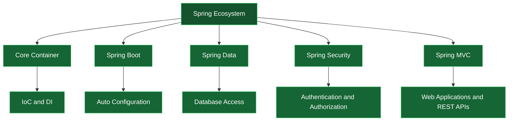
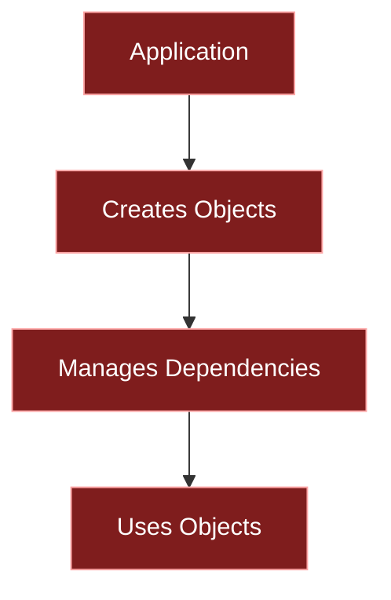
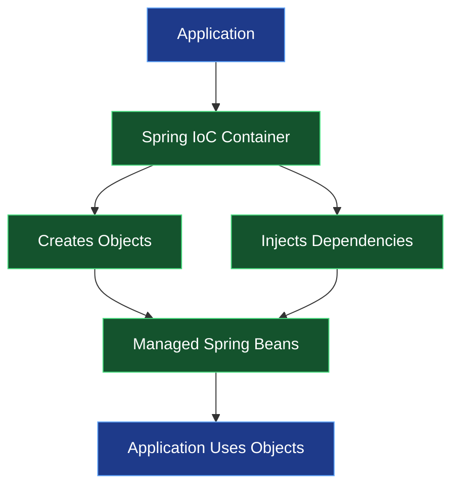
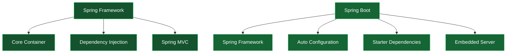
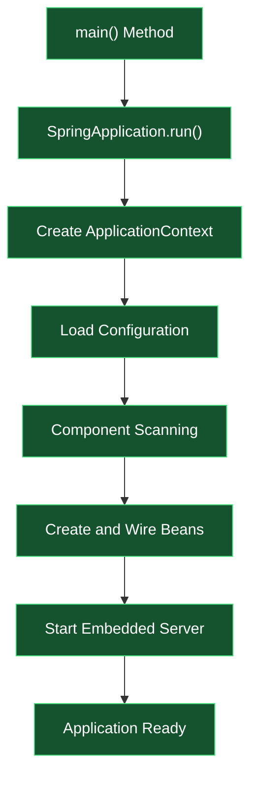
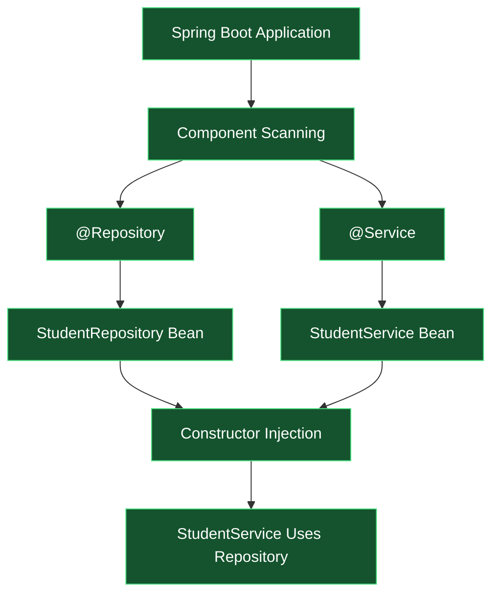
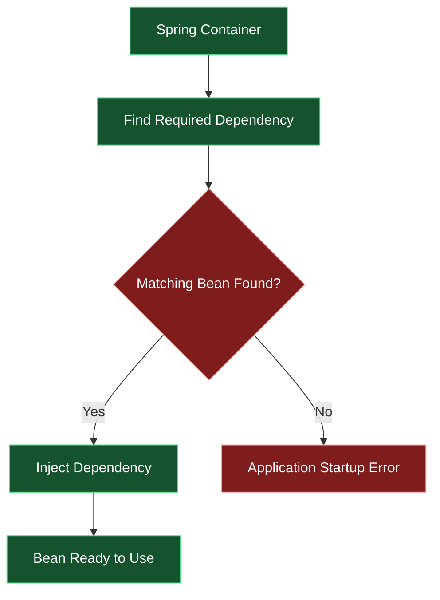
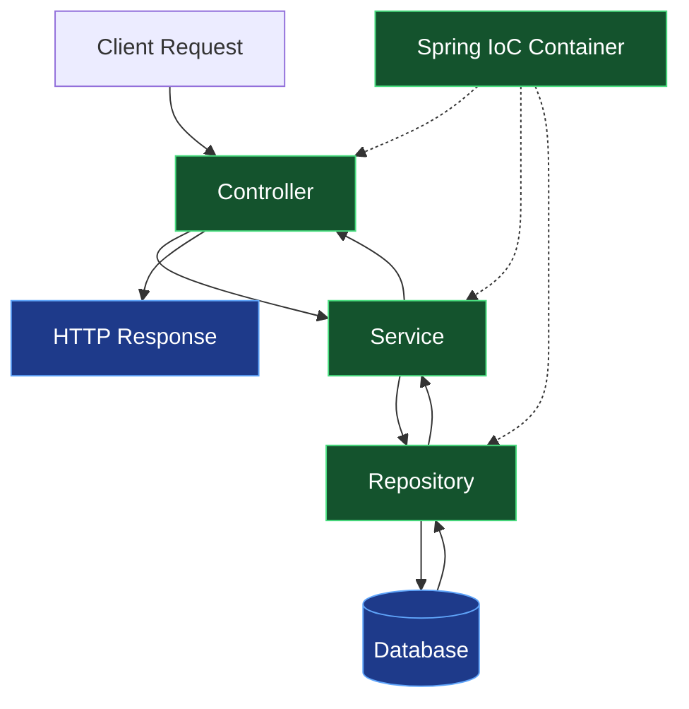

# 04 — Spring Framework | Getting Started

<div align="center">


<br/>


### From Java Fundamentals to the Spring Ecosystem

*Understanding the foundation of modern Java backend development.*

</div>

---

## 🧭 Table of Contents

1. [Introduction to Spring](#-01-introduction-to-spring)
2. [Spring Documentation](#-02-spring-documentation)
3. [Prerequisites](#-03-prerequisites)
4. [IDE for Spring Development](#-04-ide-for-spring-development)
5. [Inversion of Control and Dependency Injection](#-05-inversion-of-control-and-dependency-injection)
6. [Spring vs Spring Boot](#-06-spring-vs-spring-boot)
7. [Your First Spring Boot Application](#-07-your-first-spring-boot-application)
8. [Dependency Injection Using Spring Boot](#-08-dependency-injection-using-spring-boot)
9. [Autowiring in Spring Boot](#-09-autowiring-in-spring-boot)
10. [Complete Spring Boot Application Flow](#-10-complete-spring-boot-application-flow)
11. [Important Interview Questions](#-11-important-interview-questions)
12. [Quick Revision](#-12-quick-revision)

---

# 🌱 01. Introduction to Spring

Before understanding Spring Boot, let's understand Spring.

**Spring is a powerful Java framework used to build enterprise-level applications.**

It provides infrastructure and features that help developers build applications without manually managing every object, dependency and configuration.

### Why Do We Need Spring?

Consider a normal Java application.

Suppose we have three classes:

- Student
- StudentService
- StudentRepository

The StudentService needs StudentRepository to perform database operations.

Without Spring, we create and manage objects ourselves.

```java
StudentRepository repository = new StudentRepository();

StudentService service = new StudentService(repository);
```

This works, but as an application grows, managing dependencies manually becomes difficult.

Spring helps manage these objects and their dependencies.

### What Does Spring Provide?

- Dependency Injection.
- Inversion of Control.
- Object lifecycle management.
- Configuration management.
- Transaction management.
- Integration with databases.
- Support for web application development.
- Integration with other Java technologies.

### Understanding the Spring Ecosystem



**Important:** Spring is the broader framework ecosystem. Spring Boot is built on top of Spring to simplify application setup and configuration.

---

# 📚 02. Spring Documentation

Official documentation is an important part of learning any framework.

Spring provides documentation for its modules, configuration, APIs, examples and best practices.

### Important Official Resources

| Resource | Purpose |
|---|---|
| [Spring Framework](https://docs.spring.io/spring-framework/reference/) | Core Spring concepts |
| [Spring Boot](https://docs.spring.io/spring-boot/index.html) | Spring Boot features and configuration |
| [Spring Initializr](https://start.spring.io/) | Generate Spring Boot projects |
| [Spring Guides](https://spring.io/guides) | Practical examples and tutorials |
| [Spring Projects](https://spring.io/projects) | Explore the Spring ecosystem |

### Why Is Documentation Important?

When working with frameworks, you will frequently encounter:

- New annotations.
- Configuration properties.
- Version changes.
- Dependency requirements.
- API changes.
- Error messages.

Instead of depending entirely on examples from the internet, learning to navigate official documentation helps you understand how things actually work.

**Developer tip:** Always check whether the documentation matches the Spring Boot version used in your project.

---

# ⚙️ 03. Prerequisites

Before starting Spring development, you should understand a few fundamentals.

### Required Knowledge

| Technology | Why It Matters |
|---|---|
| Core Java | Classes, objects, methods and interfaces |
| OOP | Encapsulation, inheritance, abstraction and polymorphism |
| Collections | Lists, Maps and other data structures |
| Exception Handling | Handling application errors |
| Interfaces | Understanding abstraction and loose coupling |
| Maven | Managing project dependencies |
| JDBC | Understanding database connectivity |
| Hibernate | Understanding ORM and persistence |

### Software Requirements

- JDK 17 or a compatible supported JDK.
- Maven.
- IntelliJ IDEA, Eclipse or another suitable Java IDE.
- Spring Initializr.
- Basic knowledge of HTTP and databases for later backend topics.

### Why Learn Maven Before Spring Boot?

Spring Boot applications commonly use Maven or Gradle.

Maven helps manage:

- External libraries.
- Project dependencies.
- Build lifecycle.
- Plugins.
- Packaging.

For example, instead of manually downloading every Spring library, Maven downloads the required dependencies.

```xml
<dependency>
    <groupId>org.springframework.boot</groupId>
    <artifactId>spring-boot-starter</artifactId>
</dependency>
```

---

# 💻 04. IDE for Spring Development

An IDE makes Java development easier by providing code completion, debugging, project management and build integration.

### Popular IDEs

| IDE | Highlights |
|---|---|
| IntelliJ IDEA | Powerful Java development experience |
| Eclipse | Extensible Java IDE |
| Spring Tools | Spring-focused development support |
| VS Code | Lightweight editor with Java extensions |

### My Recommendation

For Spring Boot development, IntelliJ IDEA is a strong choice.

You can also use Eclipse with Spring Tools.

### Important IDE Features

- Code completion.
- Dependency management.
- Maven integration.
- Debugging.
- Project navigation.
- Application execution.
- Configuration file support.

### Typical Spring Boot Project Structure

```text
spring-demo/
│
├── src/
│   ├── main/
│   │   ├── java/
│   │   │   └── com/example/demo/
│   │   │       ├── DemoApplication.java
│   │   │       ├── controller/
│   │   │       ├── service/
│   │   │       └── repository/
│   │   │
│   │   └── resources/
│   │       └── application.properties
│   │
│   └── test/
│       └── java/
│
├── pom.xml
└── mvnw
```

This is a typical structure. The exact packages and files depend on the application.

---

# 🔄 05. Inversion of Control and Dependency Injection

This is one of the most important concepts in Spring.

Let's understand both concepts separately.

## 5.1 What is Inversion of Control (IoC)?

IoC stands for **Inversion of Control**.

Normally, when we write a Java program, we create objects ourselves.

```java
StudentService service = new StudentService();
```

Here, our application controls object creation.

But in Spring, we can give this responsibility to the Spring IoC Container.

Spring creates and manages objects called **Beans**.

### Without IoC



### With IoC



**Simple definition:** Inversion of Control means transferring the responsibility of creating and managing objects from the application code to a framework or container.

## 5.2 What Is an IoC Container?

The IoC Container is responsible for:

- Creating objects.
- Configuring objects.
- Managing dependencies.
- Managing bean lifecycle.
- Providing required objects to other components.

Spring mainly provides two container interfaces:

| Interface | Description |
|---|---|
| BeanFactory | Basic IoC container |
| ApplicationContext | Advanced container with additional enterprise features |

`ApplicationContext` is commonly used in Spring applications.

## 5.3 What Is Dependency Injection (DI)?

Dependency Injection is a design pattern in which an object receives the dependencies it needs from an external source instead of creating them itself.

Consider this example:

```java
class StudentRepository {

    public void save() {
        System.out.println("Student saved");
    }
}
```

Now StudentService needs StudentRepository.

Instead of creating the repository inside the service, we inject it.

```java
class StudentService {

    private final StudentRepository repository;

    public StudentService(StudentRepository repository) {
        this.repository = repository;
    }

    public void saveStudent() {
        repository.save();
    }
}
```

The StudentService does not create its dependency. It receives it through its constructor.

### Types of Dependency Injection

**1. Constructor Injection**

Dependencies are provided through a constructor.

```java
public StudentService(StudentRepository repository) {
    this.repository = repository;
}
```

**2. Setter Injection**

Dependencies are provided through setter methods.

```java
public void setRepository(StudentRepository repository) {
    this.repository = repository;
}
```

**3. Field Injection**

Dependencies are injected directly into fields.

```java
@Autowired
private StudentRepository repository;
```

### Comparison

| Constructor Injection | Setter Injection | Field Injection |
|---|---|---|
| Uses constructor | Uses setter | Uses field |
| Supports final fields | Dependency can be changed | Direct field injection |
| Easy to unit test | Useful for optional dependencies | Harder to test in isolation |
| Recommended for required dependencies | Useful for optional dependencies | Generally discouraged |

<badge color="success">Best Practice</badge>

Prefer constructor injection for required dependencies. It makes dependencies explicit, supports immutability and simplifies unit testing.

### IoC vs DI

| IoC | DI |
|---|---|
| A broader design principle | A way to implement IoC |
| Transfers control to a container | Supplies required dependencies |
| Controls object creation and lifecycle | Handles dependency relationships |

**Remember:** IoC is the principle; DI is one of the techniques used to achieve it.

---

# ⚖️ 06. Spring vs Spring Boot

These two terms are closely related, but they are not the same.

### Spring Framework

Spring Framework provides the core infrastructure for building Java applications.

Developers may need to configure various components and dependencies themselves.

### Spring Boot

Spring Boot simplifies Spring application development by providing:

- Auto-configuration.
- Starter dependencies.
- Embedded servers.
- Production-oriented features.
- Simplified application setup.

### Spring vs Spring Boot

| Spring Framework | Spring Boot |
|---|---|
| Core Java application framework | Built on top of Spring |
| More manual configuration may be required | Provides auto-configuration |
| Dependencies may be selected individually | Provides starter dependencies |
| Server setup may require additional configuration | Embedded server support |
| Flexible configuration | Convention-based defaults |

### Visual Understanding



### What Is Auto-Configuration?

Auto-configuration means Spring Boot automatically configures application components based on the dependencies available and the application's configuration.

For example, when the web starter is added, Spring Boot can configure the infrastructure needed for a web application.

It does not mean that Spring Boot magically understands every requirement. Configuration can still be customized.

---

# 🚀 07. Your First Spring Boot Application

Now let's create our first Spring Boot application.

### Step 1: Open Spring Initializr

Visit:

[https://start.spring.io/](https://start.spring.io/)

### Step 2: Select Project Configuration

| Setting | Selection |
|---|---|
| Project | Maven |
| Language | Java |
| Spring Boot | Compatible stable release |
| Packaging | Jar |
| Java | Compatible JDK version |

### Step 3: Add Dependencies

For a basic application, select:

- Spring Web (if building a web application).

### Step 4: Generate the Project

Download the generated ZIP file and open the project in your IDE.

### Step 5: Understand the Main Class

Spring Initializr generates a main application class.

```java
package com.example.demo;

import org.springframework.boot.SpringApplication;
import org.springframework.boot.autoconfigure.SpringBootApplication;

@SpringBootApplication
public class DemoApplication {

    public static void main(String[] args) {

        SpringApplication.run(
            DemoApplication.class,
            args
        );

    }
}
```

### Understanding @SpringBootApplication

This is one of the most important annotations in Spring Boot.

It combines three annotations:

1. `@SpringBootConfiguration`
2. `@EnableAutoConfiguration`
3. `@ComponentScan`

| Annotation | Purpose |
|---|---|
| `@SpringBootConfiguration` | Identifies the class as a Spring configuration class |
| `@EnableAutoConfiguration` | Enables Spring Boot auto-configuration |
| `@ComponentScan` | Scans for Spring components |

### Understanding SpringApplication.run()

```java
SpringApplication.run(DemoApplication.class, args);
```

This starts the Spring application.

During startup, Spring Boot:

1. Creates and configures the ApplicationContext.
2. Processes configuration classes.
3. Performs auto-configuration.
4. Scans and registers components.
5. Creates and wires beans.
6. Starts the embedded web server when using a web application.

### Application Flow



---

# 💉 08. Dependency Injection Using Spring Boot

Now let's understand how Spring Boot performs Dependency Injection.

Suppose we have a StudentService class that needs StudentRepository.

Instead of creating the repository manually, we can ask Spring to manage both objects.

### Step 1: Create StudentRepository

```java
package com.example.demo.repository;

import org.springframework.stereotype.Repository;

@Repository
public class StudentRepository {

    public String getStudentData() {
        return "Student data retrieved";
    }
}
```

`@Repository` marks the class as a Spring-managed component and identifies it as a persistence-layer component.

### Step 2: Create StudentService

```java
package com.example.demo.service;

import com.example.demo.repository.StudentRepository;
import org.springframework.stereotype.Service;

@Service
public class StudentService {

    private final StudentRepository repository;

    public StudentService(StudentRepository repository) {
        this.repository = repository;
    }

    public String getStudent() {
        return repository.getStudentData();
    }
}
```

`@Service` marks the class as a service-layer component.

### Step 3: Understand What Happens

Spring detects both classes during component scanning.

It creates their objects and injects StudentRepository into StudentService.



### Important Annotations

| Annotation | Responsibility |
|---|---|
| `@Component` | Generic Spring component |
| `@Service` | Service-layer component |
| `@Repository` | Persistence-layer component |
| `@Controller` | MVC controller |
| `@RestController` | REST controller |
| `@Configuration` | Configuration class |

`@Service` and `@Repository` are specialized forms of Spring's component stereotype.

---

# 🔌 09. Autowiring in Spring Boot

Autowiring is the process through which Spring automatically resolves and injects required dependencies into a bean.

For example:

```java
@Service
public class StudentService {

    private final StudentRepository repository;

    @Autowired
    public StudentService(StudentRepository repository) {
        this.repository = repository;
    }
}
```

Spring finds a suitable StudentRepository bean and injects it.

### How Does Autowiring Work?



### Constructor Autowiring

If a class has only one constructor, Spring can automatically use it for dependency injection.

Therefore, `@Autowired` is optional in the following example:

```java
@Service
public class StudentService {

    private final StudentRepository repository;

    public StudentService(StudentRepository repository) {
        this.repository = repository;
    }
}
```

This is generally the preferred approach.

### What Happens If Multiple Beans Exist?

Suppose we have two implementations of an interface.

```java
public interface PaymentService {
    void pay();
}
```

```java
@Component
public class UpiPaymentService implements PaymentService {

    public void pay() {
        System.out.println("UPI Payment");
    }
}
```

```java
@Component
public class CardPaymentService implements PaymentService {

    public void pay() {
        System.out.println("Card Payment");
    }
}
```

Now if a service requests PaymentService, Spring finds two matching beans.

It cannot automatically decide which one should be injected unless a selection rule is provided.

### Using @Qualifier

```java
@Service
public class OrderService {

    private final PaymentService paymentService;

    public OrderService(
        @Qualifier("upiPaymentService")
        PaymentService paymentService
    ) {
        this.paymentService = paymentService;
    }
}
```

`@Qualifier` specifies which bean should be injected.

### Using @Primary

We can also mark one implementation as the default choice.

```java
@Primary
@Component
public class UpiPaymentService implements PaymentService {

    public void pay() {
        System.out.println("UPI Payment");
    }
}
```

### @Qualifier vs @Primary

| @Qualifier | @Primary |
|---|---|
| Specifies a particular bean at an injection point | Marks a default preferred bean |
| Used when selecting a specific dependency | Used when resolving multiple candidates |
| Can be applied to injection points | Applied to a bean definition |

**Remember:** Autowiring does not mean Spring injects any random object. It resolves dependencies using bean definitions and their types, qualifiers and primary status.

---

# 🔄 10. Complete Spring Boot Application Flow

Let's connect everything we've learned.

Consider a simple backend application:

A user requests student information.

The request goes through the controller, service and repository layers.



### Responsibility of Each Layer

| Layer | Responsibility |
|---|---|
| Controller | Handles incoming HTTP requests |
| Service | Contains business logic |
| Repository | Handles data access |
| Database | Stores application data |

Spring manages the components and their dependencies through its IoC container.

This layered architecture helps keep responsibilities separated and makes applications easier to maintain and test.

---

# 🎤 11. Important Interview Questions

<details>
<summary><b>Q1. What is Spring Framework?</b></summary>

Spring is a Java framework that provides infrastructure for building enterprise applications, including Dependency Injection, IoC, transaction management and web application support.

</details>

<details>
<summary><b>Q2. What is IoC?</b></summary>

Inversion of Control is a principle in which object creation and management responsibilities are transferred from application code to a container or framework.

</details>

<details>
<summary><b>Q3. What is Dependency Injection?</b></summary>

Dependency Injection is a technique in which an object receives its required dependencies from an external source rather than creating them itself.

</details>

<details>
<summary><b>Q4. What is an IoC Container?</b></summary>

It is responsible for creating, configuring and managing Spring beans and their dependencies.

</details>

<details>
<summary><b>Q5. What is the difference between BeanFactory and ApplicationContext?</b></summary>

BeanFactory provides basic IoC functionality, whereas ApplicationContext provides additional enterprise features and is commonly used in Spring applications.

</details>

<details>
<summary><b>Q6. What is a Spring Bean?</b></summary>

A Spring Bean is an object managed by the Spring IoC container.

</details>

<details>
<summary><b>Q7. What is Spring Boot?</b></summary>

Spring Boot simplifies Spring application development through auto-configuration, starter dependencies and embedded server support.

</details>

<details>
<summary><b>Q8. What is the difference between Spring and Spring Boot?</b></summary>

Spring is the underlying framework, while Spring Boot simplifies the configuration and development of applications built using Spring.

</details>

<details>
<summary><b>Q9. What is Auto-Configuration?</b></summary>

Auto-configuration automatically configures application components based on available dependencies and application settings.

</details>

<details>
<summary><b>Q10. What is @SpringBootApplication?</b></summary>

It combines @SpringBootConfiguration, @EnableAutoConfiguration and @ComponentScan.

</details>

<details>
<summary><b>Q11. What is @ComponentScan?</b></summary>

It tells Spring where to search for component classes that should be registered as beans.

</details>

<details>
<summary><b>Q12. What is Autowiring?</b></summary>

Autowiring is the process of automatically resolving and injecting dependencies into Spring-managed beans.

</details>

<details>
<summary><b>Q13. What are the types of Dependency Injection?</b></summary>

Constructor Injection, Setter Injection and Field Injection.

</details>

<details>
<summary><b>Q14. Which Dependency Injection method is recommended?</b></summary>

Constructor Injection is generally recommended for required dependencies because it supports immutability and makes dependencies explicit.

</details>

<details>
<summary><b>Q15. What is @Qualifier?</b></summary>

@Qualifier helps Spring select a specific bean when multiple beans of the same type are available.

</details>

<details>
<summary><b>Q16. What is @Primary?</b></summary>

@Primary marks a bean as the preferred candidate when multiple beans of the same type are available.

</details>

---

# 🧠 12. Quick Revision

| Concept | Remember |
|---|---|
| Spring | Java application framework |
| Spring Boot | Simplifies Spring development |
| IoC | Inversion of Control |
| DI | Dependency Injection |
| IoC Container | Creates and manages beans |
| ApplicationContext | Advanced IoC container |
| Bean | Object managed by Spring |
| @Component | Generic component |
| @Service | Service-layer component |
| @Repository | Persistence-layer component |
| @Autowired | Resolves and injects dependencies |
| @Qualifier | Selects a particular bean |
| @Primary | Marks a preferred bean |
| @SpringBootApplication | Main Spring Boot annotation |
| @ComponentScan | Searches for components |
| Auto-Configuration | Configures components automatically |
| Spring Initializr | Generates Spring Boot projects |
| Constructor Injection | Recommended DI approach |

---

## 🚀 What's Next?

You've now explored the starting concepts of the Spring ecosystem.

The next step is to move beyond understanding the framework and start building applications with it.

Potential upcoming areas include:

- Spring Core in greater depth.
- Bean lifecycle and scopes.
- Spring Configuration.
- REST API development.
- Spring MVC.
- Spring Data JPA.
- Spring Security.

**The goal is not just to learn annotations, but to understand what Spring is doing behind the scenes.**

---

<div align="center">


### JAVA BACKEND JOURNEY

**Topic:** Spring Framework — Getting Started

**Focus:** Spring Core, IoC, DI and Spring Boot

**Documentation:** Completed

*Understand the framework. Build with confidence.*

<br/>


<br/><br/>

### 👀 Documentation Visitors


**Thanks for exploring this documentation!**

<a href="https://github.com/Aradhy2005/java-backend-journey">

</a>

</div>