<div align="center">


<br/>


<br/><br/>

**JAVA BACKEND JOURNEY · CHAPTER 05**

*From creating objects ourselves to letting Spring manage them.*

</div>

---

> [!TIP]
> **The big idea:** Spring's IoC Container creates and manages objects called *beans*. It can also connect those beans by injecting the dependencies they need. This chapter explores how that works, first with traditional XML configuration and then with the annotations commonly seen in modern Spring applications.

## ✦ At a glance

| | |
|---|---|
| **Focus** | Spring Bean Management |
| **Core concepts** | IoC, beans, scopes, dependency injection |
| **Configuration** | XML-based Spring configuration |
| **Practical skills** | Create beans, inject dependencies, retrieve objects |
| **Next step** | Continue exploring Spring Framework |

### What you'll understand

- [x] Creating a basic Spring project
- [x] Defining beans using XML
- [x] How Spring creates objects
- [x] Singleton and prototype scopes
- [x] Setter and constructor injection
- [x] Connecting beans with `ref`
- [x] Programming to interfaces
- [x] XML autowiring modes
- [x] Resolving multiple candidates with `@Primary` and `@Qualifier`
- [x] Lazy initialization
- [x] Retrieving beans using `getBean()`
- [x] Inner beans and the bean lifecycle

---

## ◈ Contents

<details open>
<summary><strong>Open chapter navigation</strong></summary>

1. [The Spring Container: the central idea](#1-the-spring-container-the-central-idea)
2. [Your first Spring project](#2-your-first-spring-project)
3. [Spring Beans and XML configuration](#3-spring-beans-and-xml-configuration)
4. [How Spring creates objects](#4-how-spring-creates-objects)
5. [Bean scopes](#5-bean-scopes)
6. [Setter injection](#6-setter-injection)
7. [The ref attribute](#7-the-ref-attribute)
8. [Constructor injection](#8-constructor-injection)
9. [Interfaces and loose coupling](#9-interfaces-and-loose-coupling)
10. [Autowiring](#10-autowiring)
11. [Choosing a bean: @Primary and @Qualifier](#11-choosing-a-bean-primary-and-qualifier)
12. [Lazy initialization](#12-lazy-initialization)
13. [Retrieving beans with getBean](#13-retrieving-beans-with-getbean)
14. [Inner beans](#14-inner-beans)
15. [The bean lifecycle](#15-the-bean-lifecycle)
16. [Concept comparison sheet](#16-concept-comparison-sheet)
17. [Interview practice](#17-interview-practice)
18. [Revision map](#18-revision-map)

</details>

---

# 1. The Spring Container: the central idea

In a plain Java program, we often create objects ourselves:

```java
StudentRepository repository = new StudentRepository();
StudentService service = new StudentService(repository);
```

This is perfectly valid. But as an application grows, classes can depend on many other classes. Creating, connecting and managing every object manually becomes repetitive and tightly coupled.

Spring provides an **IoC Container** to take responsibility for creating and managing application objects.

### The relationship

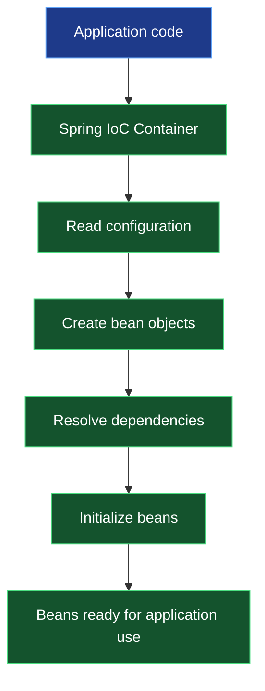

### Key terms

| Term | Meaning |
|---|---|
| **IoC (Inversion of Control)** | Control over object creation and wiring is given to the container |
| **DI (Dependency Injection)** | A dependency is supplied to an object rather than created by that object |
| **Bean** | An object managed by the Spring container |
| **Container** | The Spring component that creates, configures and manages beans |
| **Configuration** | Instructions that tell Spring which beans to create and how to connect them |

<details>
<summary><strong>Quick check: Is every Java object a Spring Bean?</strong></summary>

No. A Java object becomes a Spring Bean when it is registered with and managed by the Spring container. Objects created with `new` in ordinary application code are not automatically Spring Beans.

</details>

---

# 2. Your first Spring project

A traditional XML-based Spring project can be created as a Maven project with the required Spring Context dependency.

### Project structure

```text
spring-bean-demo/
├── pom.xml
└── src/
    └── main/
        ├── java/
        │   └── com/example/
        │       ├── App.java
        │       └── Student.java
        └── resources/
            └── spring.xml
```

### Maven dependency

Add the Spring Context dependency to `pom.xml`. Use a Spring version compatible with your Java version and project setup.

```xml
<dependency>
    <groupId>org.springframework</groupId>
    <artifactId>spring-context</artifactId>
    <version>${spring.version}</version>
</dependency>
```

Define the `spring.version` property in the Maven properties section, using the version selected for your project.

### Student.java

```java
package com.example;

public class Student {

    public void display() {
        System.out.println("Student bean is working!");
    }
}
```

### spring.xml

```xml
<?xml version="1.0" encoding="UTF-8"?>
<beans xmlns="http://www.springframework.org/schema/beans"
       xmlns:xsi="http://www.w3.org/2001/XMLSchema-instance"
       xsi:schemaLocation="
           http://www.springframework.org/schema/beans
           https://www.springframework.org/schema/beans/spring-beans.xsd">

    <bean id="student" class="com.example.Student"/>

</beans>
```

### App.java

```java
package com.example;

import org.springframework.context.support.ClassPathXmlApplicationContext;

public class App {

    public static void main(String[] args) {

        try (ClassPathXmlApplicationContext context =
                 new ClassPathXmlApplicationContext("spring.xml")) {

            Student student =
                context.getBean("student", Student.class);

            student.display();
        }
    }
}
```

**Expected output**

```text
Student bean is working!
```

### What happened?

1. `ClassPathXmlApplicationContext` loaded `spring.xml` from the classpath.
2. Spring read the bean definition.
3. Spring created the `Student` object.
4. `getBean()` retrieved the managed object.
5. The method was called.
6. Closing the context triggered applicable container shutdown callbacks.

> [!NOTE]
> XML configuration is a traditional Spring approach and is useful for understanding the container. Modern Spring applications commonly use Java configuration, component scanning and annotations.

---

# 3. Spring Beans and XML configuration

A **Spring Bean** is an object instantiated, assembled and managed by the Spring IoC Container.

A bean definition tells Spring how to create and configure an object.

### Anatomy of a bean definition

```xml
<bean id="student" class="com.example.Student"/>
```

| Attribute | Purpose |
|---|---|
| `id` | Name used to identify the bean |
| `class` | Fully qualified class name Spring should instantiate |

The `id` is the bean's identifier in this configuration. The `class` tells Spring which Java class to create.

### Bean definition vs bean instance

- **Bean definition:** the configuration/instructions.
- **Bean instance:** the actual object created from those instructions.


### XML configuration and annotation configuration

| XML configuration | Annotation / Java configuration |
|---|---|
| Bean declared in XML | Bean discovered or declared in Java |
| Uses `<bean>` | Uses `@Component`, `@Service`, `@Bean`, etc. |
| Configuration is external | Configuration is closer to Java code |
| Common in legacy applications | Common in modern Spring applications |

---

# 4. How Spring creates objects

With manual creation:

```java
Student student = new Student();
```

With Spring, define the bean and ask the container for it.

```xml
<bean id="student" class="com.example.Student"/>
```

```java
Student student = context.getBean("student", Student.class);
```

The important difference is not merely *where* the object is created. It is that Spring knows about the bean and can manage its configuration, dependencies and lifecycle.

### The sequence

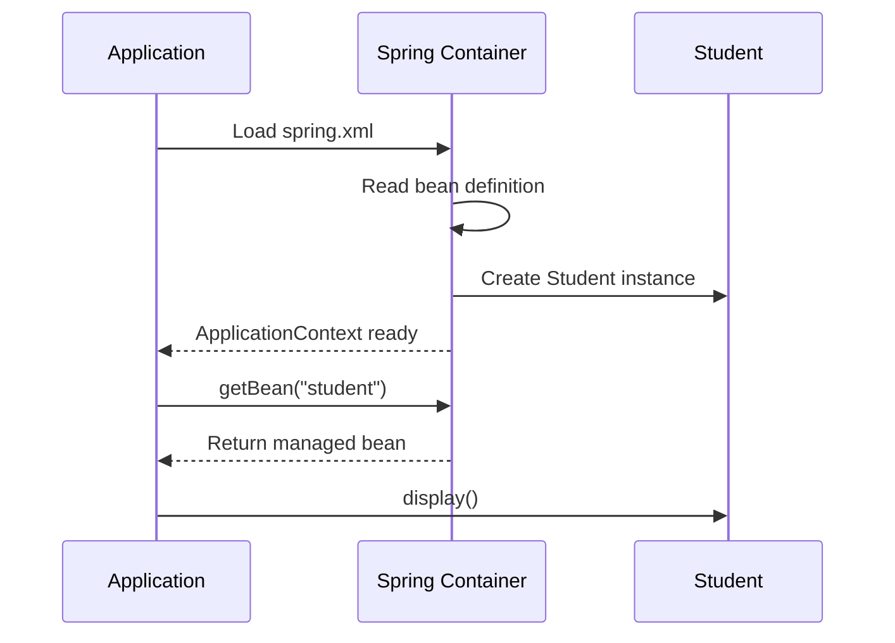

**Remember:** A bean definition does not itself represent the Java object. It describes how Spring should create and configure that object.

---

# 5. Bean scopes

A bean's **scope** determines how Spring creates and shares its instances.

### The two scopes to understand first

<details open>
<summary><strong>Singleton — one shared instance</strong></summary>

Singleton is the default scope.

```xml
<bean id="student"
      class="com.example.Student"
      scope="singleton"/>
```

For a given bean definition, the container maintains one shared instance.

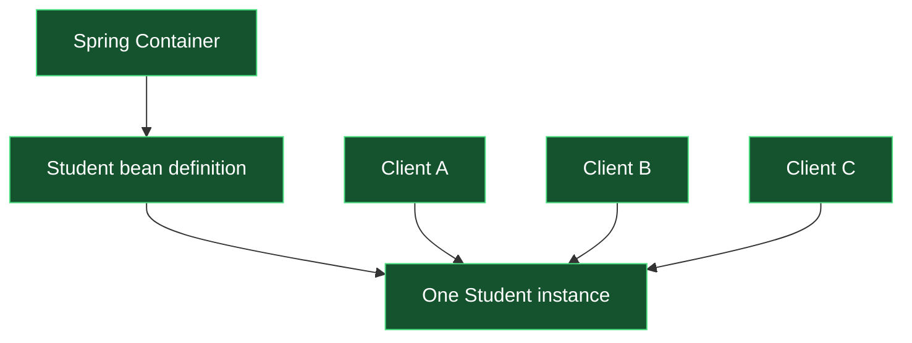

</details>

<details>
<summary><strong>Prototype — a new instance for each lookup</strong></summary>

```xml
<bean id="student"
      class="com.example.Student"
      scope="prototype"/>
```

Each request to the container for this bean creates a new instance.

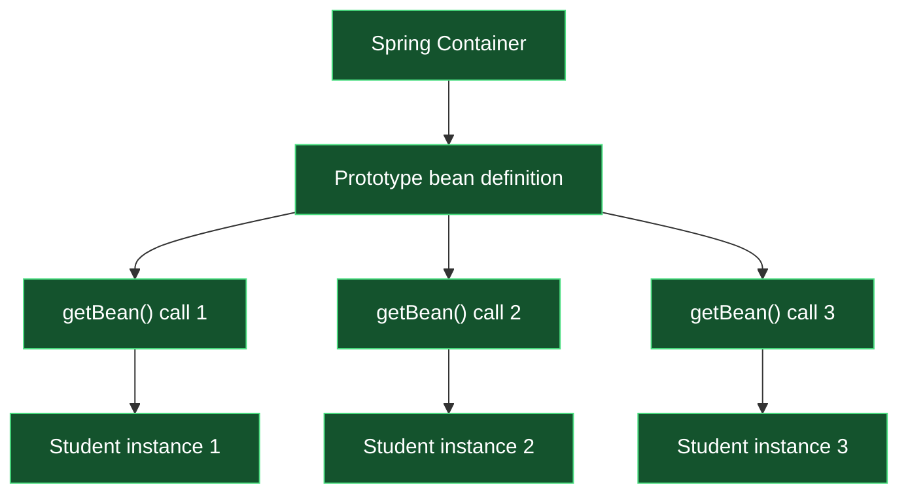

</details>

### Test it

```java
Student first = context.getBean("student", Student.class);
Student second = context.getBean("student", Student.class);

System.out.println(first == second);
```

| Scope | Result |
|---|---|
| Singleton | `true` |
| Prototype | `false` |

### All standard Spring scopes

| Scope | Meaning |
|---|---|
| `singleton` | One shared instance per bean definition per container |
| `prototype` | New instance for each container lookup |
| `request` | One instance per HTTP request |
| `session` | One instance per HTTP session |
| `application` | One instance per ServletContext |
| `websocket` | One instance per WebSocket session |

The last four are web-aware scopes and require a suitable web application context.

> [!WARNING]
> Spring does not manage the complete destruction lifecycle of prototype beans after returning them to the caller. The application is responsible for cleaning up resources held by prototype objects when needed.

---

# 6. Setter injection

**Setter Injection** supplies a dependency through a setter method.

Imagine `StudentService` needs `StudentRepository` to save student data.

### StudentRepository.java

```java
package com.example;

public class StudentRepository {

    public void save() {
        System.out.println("Student data saved.");
    }
}
```

### StudentService.java

```java
package com.example;

public class StudentService {

    private StudentRepository repository;

    public void setRepository(StudentRepository repository) {
        this.repository = repository;
    }

    public void saveStudent() {
        repository.save();
    }
}
```

### spring.xml

```xml
<bean id="repository"
      class="com.example.StudentRepository"/>

<bean id="service"
      class="com.example.StudentService">

    <property name="repository" ref="repository"/>

</bean>
```

### Follow the injection

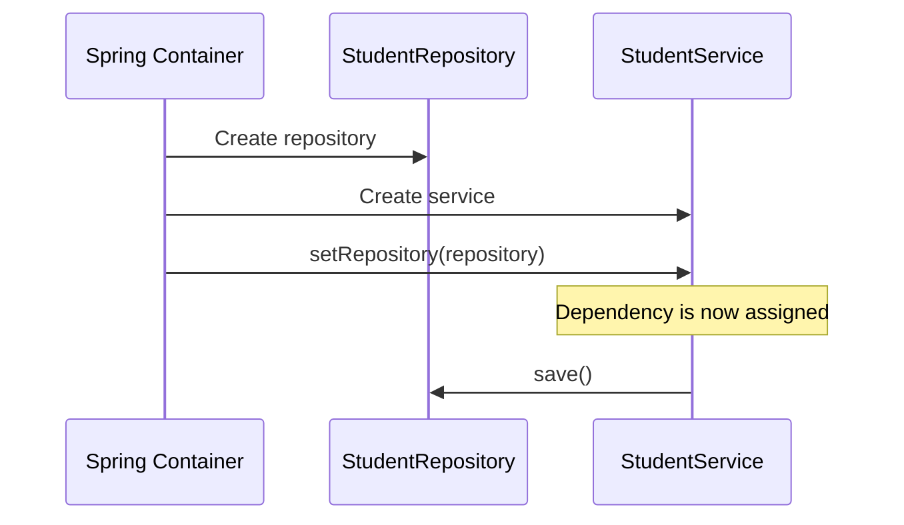

### Understand the XML

```xml
<property name="repository" ref="repository"/>
```

- `name="repository"` maps to the JavaBean property and its setter, `setRepository()`.
- `ref="repository"` points to the Spring bean whose ID is `repository`.

**When useful:** Setter injection can be appropriate for optional or changeable dependencies. For mandatory dependencies, constructor injection is generally the better default.

---

# 7. The `ref` attribute

The `ref` attribute connects one Spring bean to another in XML configuration.

```xml
<bean id="repository"
      class="com.example.StudentRepository"/>

<bean id="service"
      class="com.example.StudentService">

    <property name="repository" ref="repository"/>

</bean>
```

Here, `service` receives the bean identified by `repository`.

### `ref` vs `value`

| `ref` | `value` |
|---|---|
| Refers to another bean | Supplies a literal value |
| Used for object dependencies | Used for simple values |
| Connects managed objects | Configures a property value |

Example:

```xml
<bean id="student" class="com.example.Student">
    <property name="name" value="Aradhy"/>
    <property name="repository" ref="repository"/>
</bean>
```

The `name` property receives a string. The `repository` property receives another bean.

---

# 8. Constructor injection

**Constructor Injection** supplies dependencies through a class constructor.

It is generally preferred for mandatory dependencies because the object cannot be constructed without receiving them.

### StudentService.java

```java
package com.example;

public class StudentService {

    private final StudentRepository repository;

    public StudentService(StudentRepository repository) {
        this.repository = repository;
    }

    public void saveStudent() {
        repository.save();
    }
}
```

### spring.xml

```xml
<bean id="repository"
      class="com.example.StudentRepository"/>

<bean id="service"
      class="com.example.StudentService">

    <constructor-arg ref="repository"/>

</bean>
```

### How it works

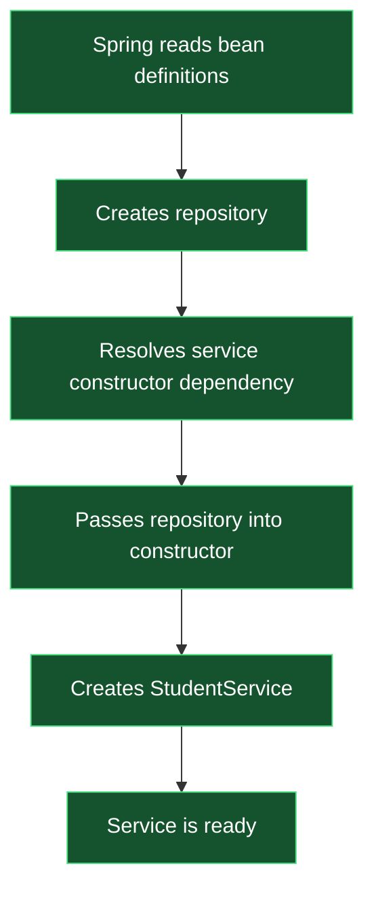

### Multiple constructor arguments

```java
public class StudentService {

    private final StudentRepository repository;
    private final String department;

    public StudentService(
            StudentRepository repository,
            String department) {

        this.repository = repository;
        this.department = department;
    }
}
```

```xml
<bean id="service" class="com.example.StudentService">
    <constructor-arg ref="repository"/>
    <constructor-arg value="Computer Science"/>
</bean>
```

### Setter vs constructor injection

| Setter injection | Constructor injection |
|---|---|
| Uses setter methods | Uses constructors |
| Can suit optional dependencies | Ideal for required dependencies |
| Dependency can be reassigned through setter | Can support `final` fields |
| Object can exist before setter assignment | Dependency is supplied during construction |
| Useful for optional configuration | Preferred for mandatory dependencies |

> [!IMPORTANT]
> Constructor injection is generally recommended for required dependencies. It makes dependencies explicit, supports immutable fields and helps ensure an object is created in a valid state.

---

# 9. Interfaces and loose coupling

An interface lets a class depend on an abstraction instead of a specific implementation.

Consider a payment feature. An application might support UPI and card payments.

### 1 — Define the contract

```java
public interface PaymentService {
    void pay();
}
```

### 2 — Create implementations

```java
public class UpiPaymentService implements PaymentService {

    @Override
    public void pay() {
        System.out.println("Payment through UPI");
    }
}
```

```java
public class CardPaymentService implements PaymentService {

    @Override
    public void pay() {
        System.out.println("Payment through card");
    }
}
```

### 3 — Depend on the interface

```java
public class OrderService {

    private final PaymentService paymentService;

    public OrderService(PaymentService paymentService) {
        this.paymentService = paymentService;
    }

    public void placeOrder() {
        paymentService.pay();
    }
}
```

`OrderService` does not need to know whether payment is made through UPI or card. It only knows the `PaymentService` contract.

### 4 — Choose the implementation in XML

```xml
<bean id="upiPayment"
      class="com.example.UpiPaymentService"/>

<bean id="orderService"
      class="com.example.OrderService">

    <constructor-arg ref="upiPayment"/>

</bean>
```

To use the card implementation, change the reference to `cardPayment` and define that bean.

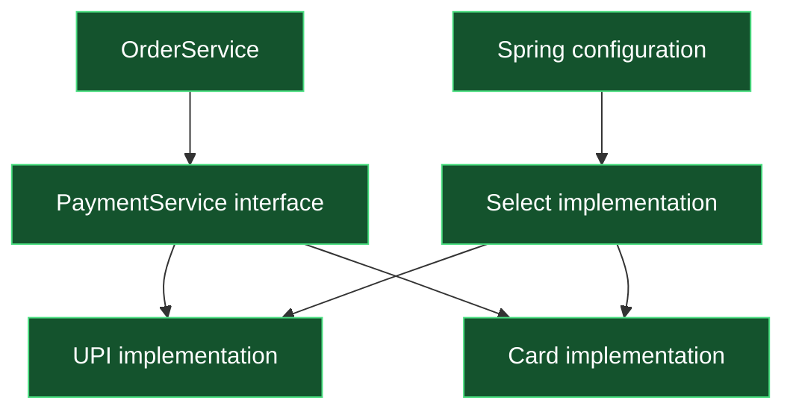

### Why this matters

- Less tight coupling
- Easier testing with alternative implementations
- Easier extension when new implementations are added
- Cleaner separation between a contract and its implementation

**Real-world connection:** The same design can be used for notification providers, storage services, payment gateways and messaging systems.

---

# 10. Autowiring

Until now, XML configuration explicitly connected dependencies with `ref`.

**Autowiring** allows Spring to resolve dependencies automatically using matching rules.

### Traditional XML autowiring modes

| Mode | How Spring resolves the dependency |
|---|---|
| `no` | No automatic wiring; explicit configuration is used |
| `byName` | Matches the property name with a bean ID |
| `byType` | Matches the required property type |
| `constructor` | Resolves constructor arguments by type |

### `byName`

Java setter:

```java
public void setRepository(StudentRepository repository) {
    this.repository = repository;
}
```

XML:

```xml
<bean id="repository"
      class="com.example.StudentRepository"/>

<bean id="service"
      class="com.example.StudentService"
      autowire="byName"/>
```

Spring looks for a bean ID matching the property name: `repository`.

### `byType`

```xml
<bean id="repository"
      class="com.example.StudentRepository"/>

<bean id="service"
      class="com.example.StudentService"
      autowire="byType"/>
```

Spring looks for a suitable bean of the required property type. If more than one candidate matches, the dependency is ambiguous unless the configuration resolves it.

### `constructor`

```xml
<bean id="repository"
      class="com.example.StudentRepository"/>

<bean id="service"
      class="com.example.StudentService"
      autowire="constructor"/>
```

Spring attempts to resolve constructor dependencies using matching bean types.

### Visual summary

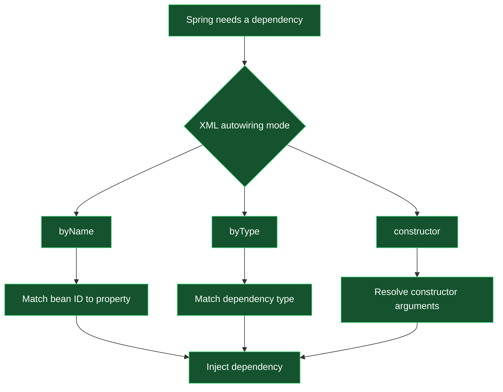

> [!NOTE]
> These are traditional XML autowiring modes. Modern Spring projects commonly use component scanning and constructor injection rather than relying on XML's `autowire` attribute.

---

# 11. Choosing a bean: `@Primary` and `@Qualifier`

What happens when multiple beans implement the same interface?

Suppose Spring finds both `UpiPaymentService` and `CardPaymentService` when a class asks for `PaymentService`.

Spring needs a way to identify the intended candidate.

## `@Primary` — set the preferred candidate

```java
@Component
@Primary
public class UpiPaymentService implements PaymentService {

    @Override
    public void pay() {
        System.out.println("UPI payment");
    }
}
```

When multiple candidates match, Spring prefers the primary bean for a single-valued injection point, unless a more specific resolution rule applies.

## `@Qualifier` — select a specific candidate

```java
@Service
public class OrderService {

    private final PaymentService paymentService;

    public OrderService(
            @Qualifier("cardPaymentService")
            PaymentService paymentService) {

        this.paymentService = paymentService;
    }
}
```

The qualifier narrows the candidate selection to the intended bean.

### Compare them

| `@Primary` | `@Qualifier` |
|---|---|
| Marks a preferred candidate | Narrows selection to a named/qualified candidate |
| Useful as a default choice | Useful when a particular implementation is required |
| Applied to bean definition | Commonly used at injection point |

**Memory hook:** `@Primary` says *prefer this one*. `@Qualifier` says *use this particular one*.

---

# 12. Lazy initialization

By default, singleton beans are generally created while the ApplicationContext is initialized.

**Lazy initialization** delays creating a bean until it is first needed.

### Eager singleton

```xml
<bean id="student"
      class="com.example.Student"/>
```

The singleton bean is normally created during container initialization.

### Lazy singleton

```xml
<bean id="student"
      class="com.example.Student"
      lazy-init="true"/>
```

Spring delays creating this bean until it is requested, unless another eager bean needs it as a dependency.

### Compare the flow

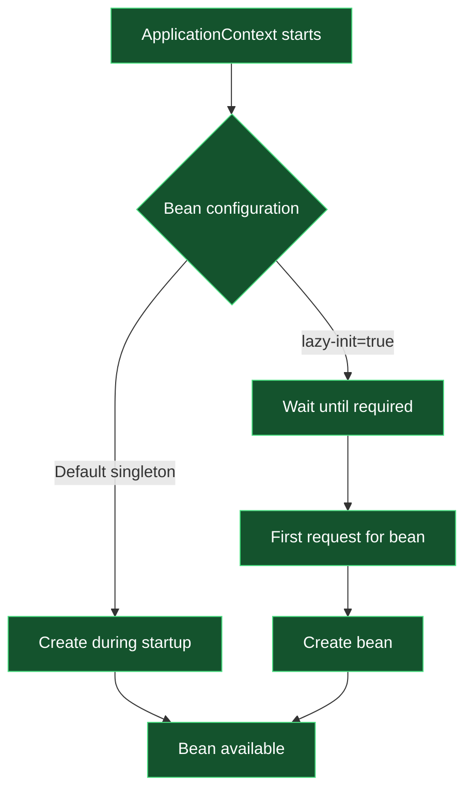

### Annotation-based equivalent

```java
@Component
@Lazy
public class StudentService {
}
```

### When is it useful?

- When a bean is expensive to initialize.
- When a component may not be used in every application run.
- When delaying some startup work is beneficial.

**Important:** Lazy initialization does not guarantee that a bean will remain uncreated until an explicit `getBean()` call. An eager singleton that directly depends on a lazy bean can cause that dependency to be created during startup.

---

# 13. Retrieving beans with `getBean()`

The `ApplicationContext` provides `getBean()` methods to retrieve Spring-managed objects.

### By bean name

```java
Student student = context.getBean("student", Student.class);
```

### By type

```java
Student student = context.getBean(Student.class);
```

### By name only

```java
Object student = context.getBean("student");
```

The last form returns an `Object`, so a cast may be needed.

### Important exception: multiple candidates

If multiple beans match a type-based lookup:

```java
PaymentService payment =
    context.getBean(PaymentService.class);
```

Spring may throw `NoUniqueBeanDefinitionException`.

Use a unique bean name or otherwise resolve the ambiguity.

| Lookup | What it uses |
|---|---|
| `getBean("student")` | Bean name |
| `getBean("student", Student.class)` | Bean name and expected type |
| `getBean(Student.class)` | Bean type |

---

# 14. Inner beans

An **inner bean** is declared inside another bean's property or constructor configuration.

It is useful when a dependency is intended to be used only by its owning bean.

### Separate bean definitions

```xml
<bean id="repository"
      class="com.example.StudentRepository"/>

<bean id="service"
      class="com.example.StudentService">

    <property name="repository" ref="repository"/>

</bean>
```

The repository has its own bean definition and can be referenced elsewhere.

### Inner bean definition

```xml
<bean id="service"
      class="com.example.StudentService">

    <property name="repository">
        <bean class="com.example.StudentRepository"/>
    </property>

</bean>
```

The repository definition is nested inside the service definition.

### Visual idea

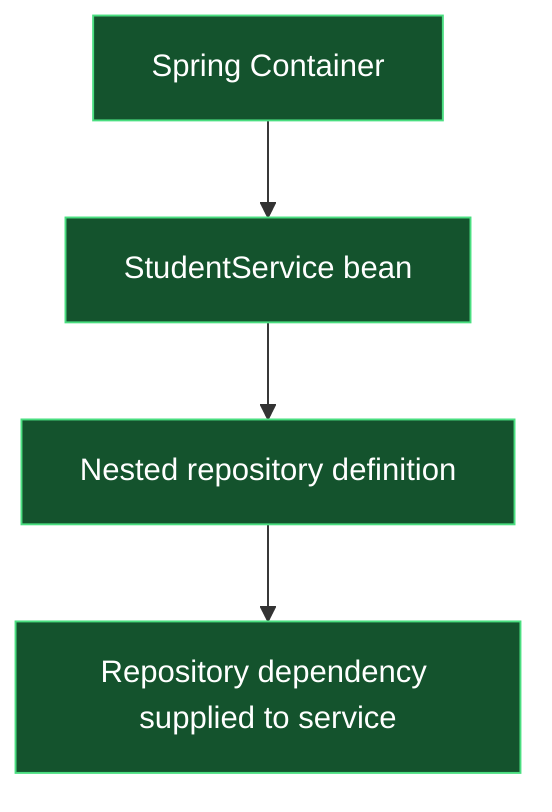

| Separate bean | Inner bean |
|---|---|
| Has its own bean definition | Defined inside another bean |
| Can be referenced by other beans | Not independently addressable by its own bean ID |
| Useful for reusable dependencies | Useful for owner-specific dependencies |

---

# 15. The bean lifecycle

The bean lifecycle describes the major stages a Spring-managed bean passes through.

### Simplified lifecycle

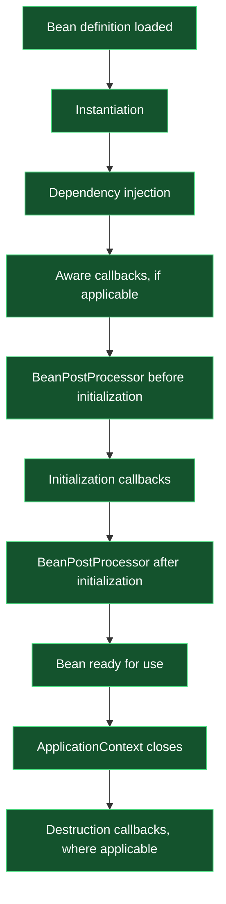

### Main stages

| Stage | What happens |
|---|---|
| Definition loading | Spring reads the bean's configuration |
| Instantiation | The object is created |
| Dependency injection | Required dependencies are supplied |
| Initialization processing | Applicable callbacks and post-processors run |
| Ready for use | The bean is available to the application |
| Destruction | Applicable cleanup callbacks run when the context shuts down |

The complete lifecycle has additional extension points, including `BeanFactoryPostProcessor`, `BeanPostProcessor`, awareness interfaces and initialization/destruction callbacks.

### Singleton vs prototype lifecycle reminder

- Spring manages the creation and normal lifecycle callbacks of singleton beans.
- Spring creates and configures prototype beans but does not automatically perform their complete destruction lifecycle after handing them to the caller.

---

# 16. Concept comparison sheet

| Concept A | Concept B | Main difference |
|---|---|---|
| Singleton | Prototype | Shared instance vs new instance per lookup |
| Setter injection | Constructor injection | Setter method vs constructor |
| `ref` | `value` | Bean reference vs literal value |
| `byName` | `byType` | Bean ID matching vs type matching |
| `@Primary` | `@Qualifier` | Preferred candidate vs explicit narrowing |
| Eager | Lazy | Startup creation vs delayed creation |
| Separate bean | Inner bean | Independent definition vs nested definition |
| XML | Annotation configuration | External XML vs Java annotations/configuration |

---

# 17. Interview practice

<details>
<summary><strong>1. What is a Spring Bean?</strong></summary>

An object instantiated, configured and managed by the Spring IoC Container.

</details>

<details>
<summary><strong>2. What is the default bean scope?</strong></summary>

Singleton. One shared instance is maintained per bean definition per container.

</details>

<details>
<summary><strong>3. What is the difference between singleton and prototype?</strong></summary>

Singleton returns the same shared instance for repeated lookups of a bean definition. Prototype creates a new instance for each lookup.

</details>

<details>
<summary><strong>4. What is dependency injection?</strong></summary>

It is a technique in which an object receives the dependencies it needs from an external source, such as the Spring container.

</details>

<details>
<summary><strong>5. Which injection approach is generally preferred?</strong></summary>

Constructor injection for mandatory dependencies because it makes requirements explicit and supports immutable fields.

</details>

<details>
<summary><strong>6. What does `ref` do in XML?</strong></summary>

It references another bean definition so Spring can inject that bean as a dependency.

</details>

<details>
<summary><strong>7. What is autowiring?</strong></summary>

Autowiring is Spring's automatic resolution and injection of dependencies based on matching rules.

</details>

<details>
<summary><strong>8. What happens if two beans match by type?</strong></summary>

Spring may report ambiguity. A primary bean, qualifier or explicit bean reference can resolve the choice.

</details>

<details>
<summary><strong>9. What is lazy initialization?</strong></summary>

It delays bean creation until the bean is first required, subject to dependency relationships.

</details>

<details>
<summary><strong>10. What does `getBean()` do?</strong></summary>

It retrieves a bean from the ApplicationContext by name or type.

</details>

<details>
<summary><strong>11. Does Spring destroy prototype beans automatically?</strong></summary>

Spring does not manage the complete destruction lifecycle of prototype beans after handing them to the caller.

</details>

<details>
<summary><strong>12. Why inject an interface instead of a concrete class?</strong></summary>

It reduces coupling and makes implementations easier to replace, extend and test.

</details>

---

# 18. Revision map

<div align="center">

### THE COMPLETE CHAPTER IN ONE VIEW

</div>

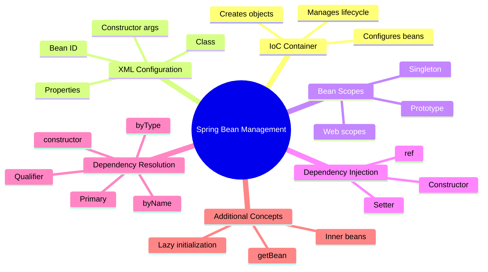

### Final revision checklist

- [ ] Explain what makes an object a Spring Bean.
- [ ] Create a bean using XML configuration.
- [ ] Load XML using `ClassPathXmlApplicationContext`.
- [ ] Retrieve a bean using `getBean()`.
- [ ] Demonstrate singleton and prototype scopes.
- [ ] Implement setter injection.
- [ ] Implement constructor injection.
- [ ] Explain why interfaces reduce coupling.
- [ ] Understand the XML autowiring modes.
- [ ] Resolve multiple candidates with `@Primary` and `@Qualifier`.
- [ ] Explain lazy initialization.
- [ ] Describe inner beans and the bean lifecycle.

---

<div align="center">


### JAVA BACKEND JOURNEY

**Chapter 05 · Exploring Spring Framework**

*Learn it. Understand it. Implement it. Document it.*

<br/>


<br/><br/>

<a href="https://github.com/Aradhy2005/java-backend-journey">
  
</a>

</div>
