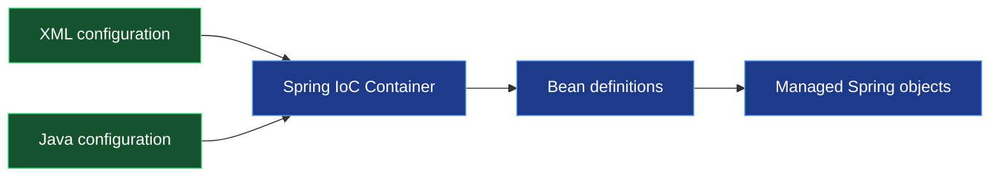
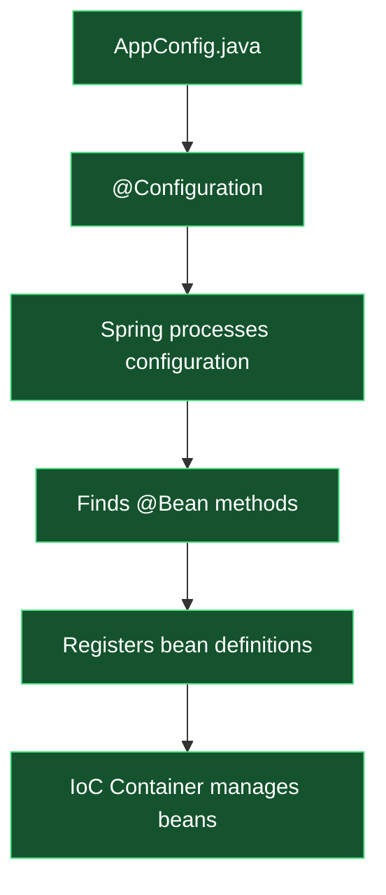
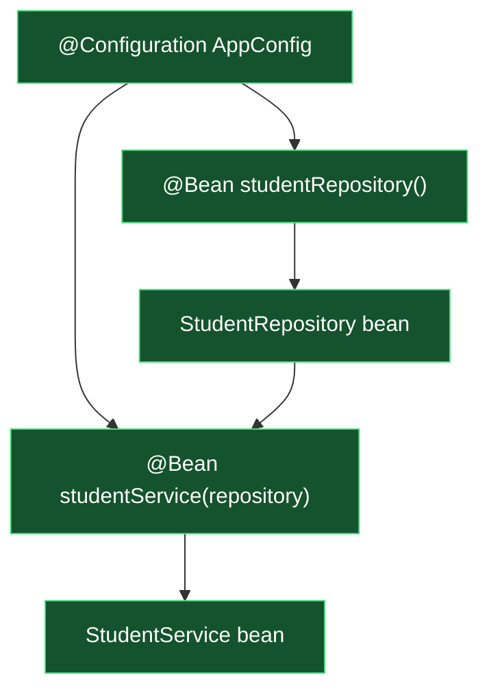
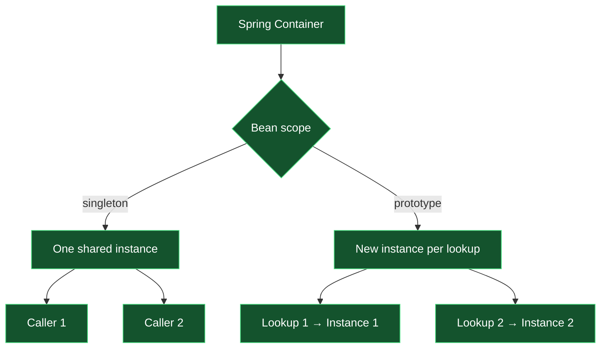
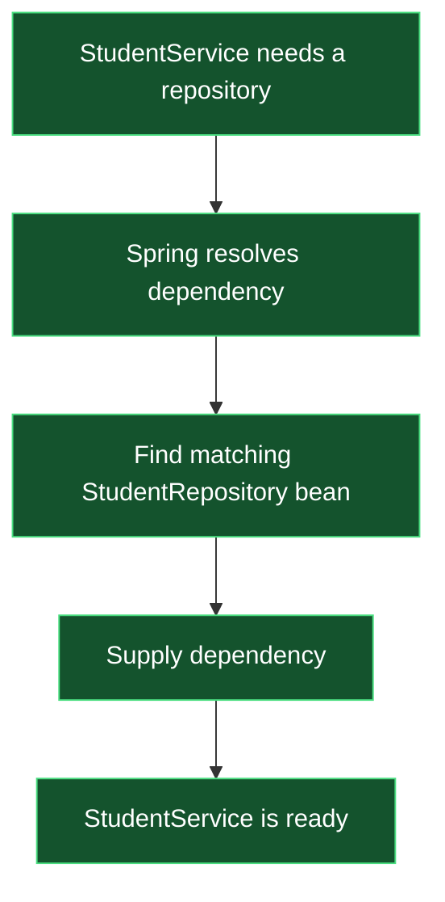
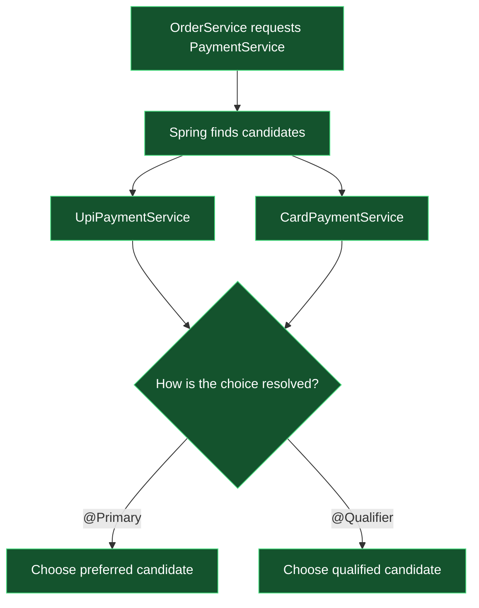
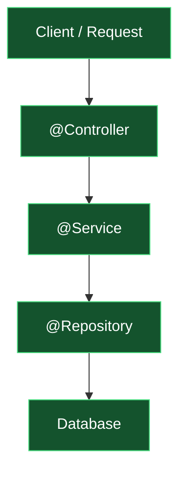
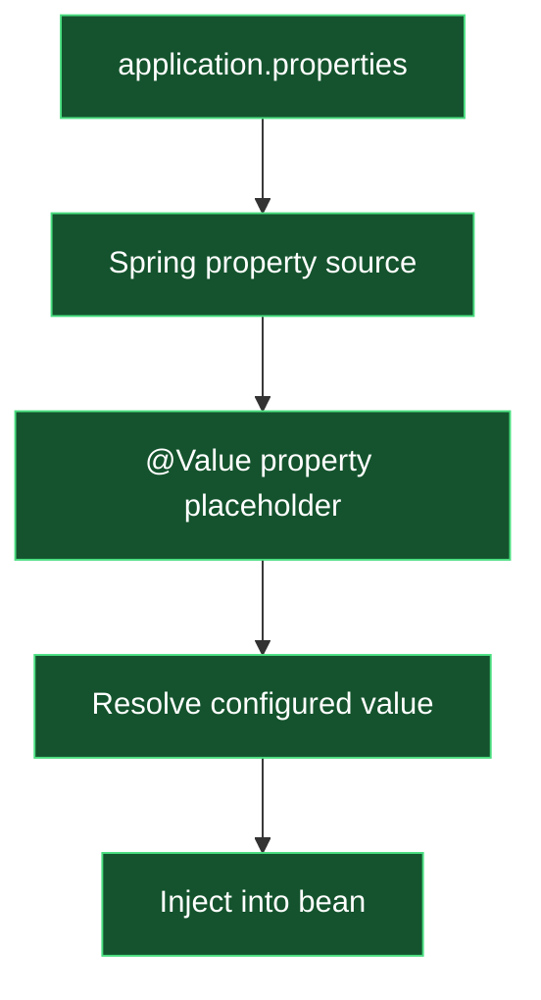
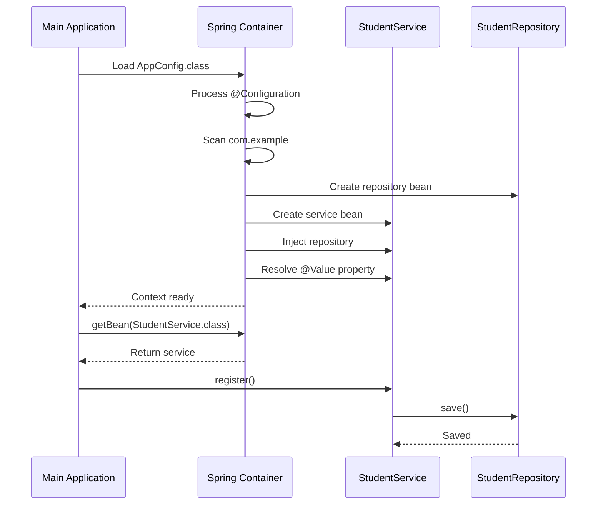
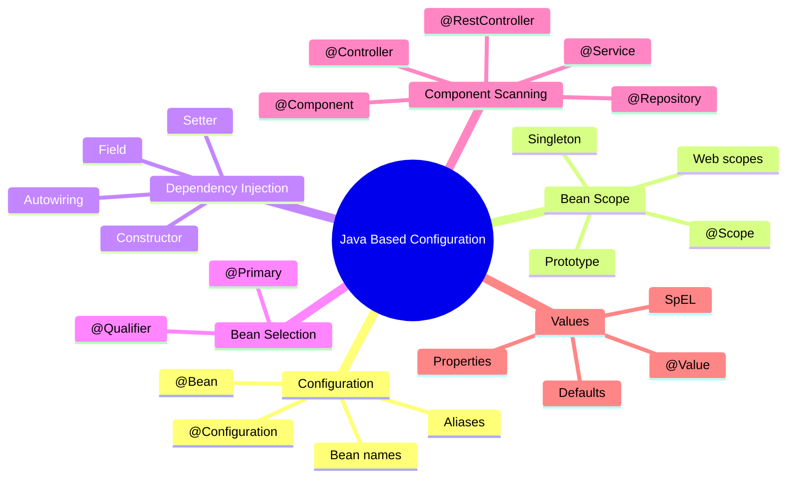

<div align="center">


<br/>


<br/><br/>

**JAVA BACKEND JOURNEY · CHAPTER 06**

*Move Spring configuration from XML into readable, maintainable Java code.*

</div>

---

> [!TIP]
> **The central idea:** Java-based configuration lets you define and configure Spring beans using Java classes and annotations instead of declaring every bean in an XML file. It keeps configuration close to the code, gives you compiler support, and works naturally with component scanning and dependency injection.

## ✦ Chapter snapshot

| | |
|---|---|
| **Focus** | Spring Java-based configuration |
| **Configuration foundation** | `@Configuration`, `@Bean` |
| **Bean identification** | Bean names and aliases |
| **Dependency injection** | `@Autowired`, constructor, setter and field injection |
| **Bean selection** | `@Primary`, `@Qualifier` |
| **Component discovery** | `@Component`, `@Service`, `@Repository`, `@Controller` |
| **Configuration values** | `@Value` |
| **Scope management** | `@Scope`, singleton, prototype and web scopes |

### What this guide covers

- [x] Java-based configuration
- [x] Bean names and aliases
- [x] Scope annotations
- [x] Autowiring
- [x] `@Primary` and `@Qualifier`
- [x] Component stereotype annotations
- [x] Field, constructor and setter injection
- [x] Primary annotation
- [x] Scope and value annotations

<sub>Source boundary: the supplied lesson screenshot shows these nine lesson titles (176–184). The section indicator says 11/11, but the final two lesson titles are below the captured area and are not readable here. These notes cover the visible topics only; no unseen lesson titles have been guessed.</sub>

---

## ◈ Contents

<details open>
<summary><strong>Open chapter navigation</strong></summary>

1. [Why Java-based configuration?](#1-why-java-based-configuration)
2. [Create a Java configuration project](#2-create-a-java-configuration-project)
3. [The @Configuration annotation](#3-the-configuration-annotation)
4. [The @Bean annotation](#4-the-bean-annotation)
5. [Bean names and aliases](#5-bean-names-and-aliases)
6. [Bean scopes with @Scope](#6-bean-scopes-with-scope)
7. [Dependency injection and autowiring](#7-dependency-injection-and-autowiring)
8. [Field, constructor and setter injection](#8-field-constructor-and-setter-injection)
9. [Multiple beans: @Primary and @Qualifier](#9-multiple-beans-primary-and-qualifier)
10. [Component stereotype annotations](#10-component-stereotype-annotations)
11. [The @Value annotation](#11-the-value-annotation)
12. [How the pieces work together](#12-how-the-pieces-work-together)
13. [XML vs Java-based configuration](#13-xml-vs-java-based-configuration)
14. [Common mistakes and debugging](#14-common-mistakes-and-debugging)
15. [Interview questions](#15-interview-questions)
16. [Revision map and checklist](#16-revision-map-and-checklist)

</details>

---

# 1. Why Java-based configuration?

In the previous chapter, beans were declared in an XML file:

```xml
<bean id="studentService"
      class="com.example.service.StudentService"/>
```

Spring can also read bean definitions from Java configuration:

```java
@Configuration
public class AppConfig {

    @Bean
    public StudentService studentService() {
        return new StudentService();
    }
}
```

Both approaches tell Spring how to create and manage beans. The difference is where the configuration is written.

### The shift



### Why developers use Java configuration

- **Type safety:** Java compiler checks classes, method calls and types.
- **Refactoring support:** IDEs can rename and navigate Java symbols.
- **Readable configuration:** Bean creation logic can be expressed directly in Java.
- **Less XML:** No need to maintain a large collection of XML bean declarations.
- **Flexible setup:** Configuration can use ordinary Java expressions and methods.

> [!NOTE]
> Java-based configuration does not mean XML support has disappeared. Spring supports multiple configuration styles, and projects can combine them when necessary.

---

# 2. Create a Java configuration project

A simple Maven project can use Spring Context to create an `ApplicationContext` from a Java configuration class.

### Project structure

```text
spring-java-config/
├── pom.xml
└── src/
    └── main/
        └── java/
            └── com/example/
                ├── App.java
                ├── config/
                │   └── AppConfig.java
                ├── repository/
                │   └── StudentRepository.java
                └── service/
                    └── StudentService.java
```

### Maven dependency

Use a Spring Context version compatible with your Java version and the rest of your project. Keep the version in a Maven property so it can be managed centrally.

```xml
<properties>
    <spring.version>YOUR_COMPATIBLE_SPRING_VERSION</spring.version>
</properties>

<dependencies>
    <dependency>
        <groupId>org.springframework</groupId>
        <artifactId>spring-context</artifactId>
        <version>${spring.version}</version>
    </dependency>
</dependencies>
```

### StudentRepository.java

```java
package com.example.repository;

public class StudentRepository {

    public void save() {
        System.out.println("Student data saved.");
    }
}
```

### StudentService.java

```java
package com.example.service;

import com.example.repository.StudentRepository;

public class StudentService {

    private final StudentRepository repository;

    public StudentService(StudentRepository repository) {
        this.repository = repository;
    }

    public void registerStudent() {
        repository.save();
        System.out.println("Student registered.");
    }
}
```

We will register both classes as beans in the configuration class.

---

# 3. The `@Configuration` annotation

`@Configuration` marks a Java class as a source of bean definitions for the Spring container.

```java
package com.example.config;

import org.springframework.context.annotation.Configuration;

@Configuration
public class AppConfig {
}
```

Think of this class as the Java equivalent of a central bean configuration file.

### What does Spring do with it?

1. Spring receives the configuration class.
2. It processes the configuration metadata.
3. It discovers the bean definitions declared in that class.
4. It registers those definitions with the container.
5. The container creates and manages the beans according to their configuration and scope.

### Visual flow



### Important distinction

`@Configuration` does not mean every object created inside the class automatically becomes a bean. A method generally needs `@Bean` to declare its return value as a bean, or the class can enable component scanning to discover annotated components.

---

# 4. The `@Bean` annotation

`@Bean` marks a method whose returned object should be registered as a Spring bean.

```java
@Configuration
public class AppConfig {

    @Bean
    public StudentRepository studentRepository() {
        return new StudentRepository();
    }
}
```

Here:

- `@Bean` tells Spring to register the returned object.
- `studentRepository()` is the factory method.
- The returned `StudentRepository` instance becomes a Spring-managed bean.
- By default, the bean name is the method name: `studentRepository`.

### Register more than one bean

```java
@Configuration
public class AppConfig {

    @Bean
    public StudentRepository studentRepository() {
        return new StudentRepository();
    }

    @Bean
    public StudentService studentService(
            StudentRepository studentRepository) {

        return new StudentService(studentRepository);
    }
}
```

Notice that the `StudentService` method receives `StudentRepository` as a method parameter. Spring resolves that dependency and supplies the bean.

This is a clean way to express dependencies in Java configuration.

### How the beans connect



### `@Bean` vs `new`

```java
StudentRepository repository = new StudentRepository();
```

This line alone creates an ordinary Java object. It does not automatically register that object with Spring.

```java
@Bean
public StudentRepository studentRepository() {
    return new StudentRepository();
}
```

This method tells Spring to register the returned object as a bean.

> [!IMPORTANT]
> Use `@Bean` when you want explicit control over object creation, especially for classes you do not own or cannot annotate. Use component scanning when application classes are suitable for automatic discovery.

---

# 5. Bean names and aliases

Every Spring bean has a name that can be used to identify it in the container.

### Default bean name

```java
@Configuration
public class AppConfig {

    @Bean
    public StudentRepository studentRepository() {
        return new StudentRepository();
    }
}
```

The default bean name is:

```text
studentRepository
```

It comes from the `@Bean` method name.

### Set a custom bean name

```java
@Configuration
public class AppConfig {

    @Bean("studentRepo")
    public StudentRepository studentRepository() {
        return new StudentRepository();
    }
}
```

Now the bean's name is `studentRepo`.

### Define aliases

```java
@Bean(name = {"studentRepo", "repository", "repo"})
public StudentRepository studentRepository() {
    return new StudentRepository();
}
```

The first name is the primary bean name; the remaining names are aliases for the same bean.

### Retrieve by name

```java
StudentRepository repository =
    context.getBean("studentRepo", StudentRepository.class);
```

### Name vs type

| Lookup | Example | What it identifies |
|---|---|---|
| By name | `getBean("studentRepo")` | A bean using its name |
| By type | `getBean(StudentRepository.class)` | A bean matching the requested type |
| By name and type | `getBean("studentRepo", StudentRepository.class)` | A named bean with a type check |

**Remember:** Bean name is an identifier in the Spring container. It is not necessarily the Java variable name used to store the returned object.

---

# 6. Bean scopes with `@Scope`

Scope determines how Spring creates and shares instances of a bean.

The default scope is `singleton`.

### Singleton scope

```java
@Bean
@Scope("singleton")
public StudentRepository studentRepository() {
    return new StudentRepository();
}
```

For this bean definition, Spring maintains one shared instance per container.

### Prototype scope

```java
@Bean
@Scope("prototype")
public StudentRepository studentRepository() {
    return new StudentRepository();
}
```

Spring creates a new instance each time the bean is requested from the container.

### Compare the object identity

```java
StudentRepository first =
    context.getBean(StudentRepository.class);

StudentRepository second =
    context.getBean(StudentRepository.class);

System.out.println(first == second);
```

| Scope | Result |
|---|---|
| `singleton` | `true` |
| `prototype` | `false` |

### Scope diagram



### Common Spring scopes

| Scope | Meaning |
|---|---|
| `singleton` | One shared instance per bean definition per container |
| `prototype` | A new instance for each container lookup |
| `request` | One instance per HTTP request |
| `session` | One instance per HTTP session |
| `application` | One instance per ServletContext |
| `websocket` | One instance per WebSocket session |

The web scopes require a suitable web-aware Spring application context.

### A lifecycle detail worth remembering

Spring manages singleton bean destruction callbacks when the context closes. Prototype beans are created and configured by Spring, but Spring does not manage their complete destruction lifecycle after handing them to the caller.

---

# 7. Dependency injection and autowiring

A class often needs another class to perform its work. That required object is called a **dependency**.

For example:

- `StudentService` needs `StudentRepository`.
- `OrderService` needs `PaymentService`.
- `NotificationService` needs an email or SMS sender.

Dependency Injection means the dependent object receives what it needs instead of constructing the dependency itself.

### Without dependency injection

```java
public class StudentService {

    private final StudentRepository repository =
        new StudentRepository();

    public void register() {
        repository.save();
    }
}
```

`StudentService` creates its own repository. This makes the class more tightly coupled to that implementation.

### With constructor injection

```java
public class StudentService {

    private final StudentRepository repository;

    public StudentService(StudentRepository repository) {
        this.repository = repository;
    }

    public void register() {
        repository.save();
    }
}
```

Now an external configuration or container supplies the repository.

### What is autowiring?

Autowiring is Spring's process of resolving and supplying a bean's dependencies.

In Java-based configuration, a `@Bean` method can declare dependencies as parameters:

```java
@Bean
public StudentService studentService(
        StudentRepository repository) {

    return new StudentService(repository);
}
```

For component-managed classes, Spring can inject dependencies using `@Autowired` or, commonly, a single constructor without requiring the annotation.



### What if Spring finds multiple candidates?

If two or more beans match a single-valued dependency, Spring needs a way to select the correct one. This is where `@Primary` and `@Qualifier` become useful.

---

# 8. Field, constructor and setter injection

Spring supports multiple ways to inject dependencies. The three common forms are constructor, setter and field injection.

## A. Constructor injection

```java
@Component
public class StudentService {

    private final StudentRepository repository;

    public StudentService(StudentRepository repository) {
        this.repository = repository;
    }
}
```

For a class with a single constructor, Spring can use that constructor for dependency injection without an explicit `@Autowired`.

**Advantages**
- Makes required dependencies visible.
- Supports `final` fields.
- Helps create objects in a valid state.
- Makes unit testing straightforward.

## B. Setter injection

```java
@Component
public class StudentService {

    private StudentRepository repository;

    @Autowired
    public void setRepository(StudentRepository repository) {
        this.repository = repository;
    }
}
```

Spring calls the setter and supplies the matching dependency.

**Useful when**
- A dependency is optional.
- Reconfiguration through a setter is intentionally supported.
- The class design specifically calls for property-style injection.

## C. Field injection

```java
@Component
public class StudentService {

    @Autowired
    private StudentRepository repository;
}
```

Spring injects the dependency directly into the field.

**Trade-offs**
- Shorter syntax.
- Dependencies are less visible from outside the class.
- Harder to instantiate cleanly in a plain unit test.
- Cannot use a `final` field for ordinary field injection.

### Comparison table

| Constructor | Setter | Field |
|---|---|---|
| Uses constructor | Uses setter method | Uses field |
| Best for required dependencies | Suitable for optional dependencies | Concise, but less explicit |
| Supports `final` fields | Field usually remains mutable | Ordinary field injection cannot use `final` |
| Easy to test directly | Can be tested through setter | Often requires Spring or reflection |

<badge color="success">Recommended default</badge> **Prefer constructor injection for required dependencies.** Use setter injection when a dependency is genuinely optional. Field injection is generally less suitable for maintainable application code.

### Constructor injection without `@Autowired`

```java
@Component
public class StudentService {

    private final StudentRepository repository;

    public StudentService(StudentRepository repository) {
        this.repository = repository;
    }
}
```

If the class has one constructor, Spring uses it automatically. If there are multiple constructors, constructor selection needs to be made unambiguous.

---

# 9. Multiple beans: `@Primary` and `@Qualifier`

Suppose two classes implement the same interface:

```java
public interface PaymentService {
    void pay();
}
```

```java
@Component
public class UpiPaymentService implements PaymentService {

    @Override
    public void pay() {
        System.out.println("Payment through UPI");
    }
}
```

```java
@Component
public class CardPaymentService implements PaymentService {

    @Override
    public void pay() {
        System.out.println("Payment through card");
    }
}
```

Now a service asks for a `PaymentService`:

```java
@Component
public class OrderService {

    private final PaymentService paymentService;

    public OrderService(PaymentService paymentService) {
        this.paymentService = paymentService;
    }
}
```

Spring finds two matching beans. Which one should it inject?

## `@Primary`: choose a preferred default

```java
@Component
@Primary
public class UpiPaymentService implements PaymentService {

    @Override
    public void pay() {
        System.out.println("Payment through UPI");
    }
}
```

When multiple candidates match a single-valued injection point, Spring prefers the primary candidate unless a more specific selection rule applies.

## `@Qualifier`: select a specific bean

```java
@Component
public class OrderService {

    private final PaymentService paymentService;

    public OrderService(
            @Qualifier("cardPaymentService")
            PaymentService paymentService) {

        this.paymentService = paymentService;
    }
}
```

The qualifier narrows the candidates to the intended bean. By default, a component's bean name is derived from its class name with the first character lowercased, so `CardPaymentService` normally has the bean name `cardPaymentService`.

### Visual selection



### Difference at a glance

| `@Primary` | `@Qualifier` |
|---|---|
| Marks a preferred bean | Narrows selection to a specific qualified candidate |
| Useful for a default implementation | Useful when a particular implementation is required |
| Declared on the bean | Commonly declared at the injection point |

**Memory hook:** `@Primary` means *prefer this one*. `@Qualifier` means *use this specific candidate*.

---

# 10. Component stereotype annotations

So far, beans were registered explicitly using `@Bean`. Spring can also discover application classes automatically through **component scanning**.

A stereotype annotation marks a class as a candidate for component scanning.

### The main stereotype annotations

| Annotation | Typical responsibility |
|---|---|
| `@Component` | General-purpose Spring-managed component |
| `@Service` | Service/business logic layer |
| `@Repository` | Data-access or persistence layer |
| `@Controller` | Spring MVC controller layer |
| `@RestController` | REST controller; combines controller semantics with response-body behavior |

These annotations help communicate the role of a class. `@Service`, `@Repository` and `@Controller` are specialized forms of `@Component`.

## Example: a layered application

### Repository layer

```java
@Repository
public class StudentRepository {

    public void save() {
        System.out.println("Saving student data...");
    }
}
```

### Service layer

```java
@Service
public class StudentService {

    private final StudentRepository repository;

    public StudentService(StudentRepository repository) {
        this.repository = repository;
    }

    public void registerStudent() {
        repository.save();
        System.out.println("Student registered.");
    }
}
```

### Controller layer

```java
@Controller
public class StudentController {

    private final StudentService service;

    public StudentController(StudentService service) {
        this.service = service;
    }
}
```

### Enable component scanning

```java
@Configuration
@ComponentScan(basePackages = "com.example")
public class AppConfig {
}
```

Spring scans the specified package and its subpackages for eligible components.

### Layered architecture



### Important distinction

- `@Component` is a general-purpose stereotype.
- `@Service` communicates business/service-layer responsibility.
- `@Repository` communicates persistence responsibility and participates in Spring's persistence exception-translation support when applicable.
- `@Controller` is used for Spring MVC request handling.
- `@RestController` is commonly used for REST endpoints whose return values are written to the response body.

### `@Bean` vs `@Component`

| `@Bean` | `@Component` |
|---|---|
| Applied to a method | Applied to a class |
| Bean is created by the method | Spring discovers and instantiates the class |
| Useful for third-party classes and explicit construction | Useful for application classes that can be component-scanned |
| Declared in configuration | Declared on the component class |

---

# 11. The `@Value` annotation

`@Value` injects a value into a field, constructor parameter or method parameter.

It is commonly used for simple configuration values such as application names, messages, limits and externalized properties.

### Inject a literal value

```java
@Component
public class AppInfo {

    @Value("Java Backend Application")
    private String applicationName;

    public void display() {
        System.out.println(applicationName);
    }
}
```

### Inject from a properties file

Create `src/main/resources/application.properties`:

```properties
app.name=Java Backend Journey
app.version=1.0
app.max-students=100
```

Register the property source:

```java
@Configuration
@ComponentScan("com.example")
@PropertySource("classpath:application.properties")
public class AppConfig {
}
```

Inject the values:

```java
@Component
public class AppInfo {

    @Value("${app.name}")
    private String applicationName;

    @Value("${app.version}")
    private String version;

    @Value("${app.max-students}")
    private int maxStudents;

    public void display() {
        System.out.println(applicationName);
        System.out.println(version);
        System.out.println(maxStudents);
    }
}
```

### Understand the syntax

| Syntax | Meaning |
|---|---|
| `@Value("Hello")` | Injects a literal value |
| `@Value("${app.name}")` | Resolves a property placeholder |
| `@Value("${app.name:Default}")` | Uses a default if the property is not defined |
| `@Value("#{...}")` | Evaluates a Spring Expression Language (SpEL) expression |

Example with a default:

```java
@Value("${app.name:My Application}")
private String applicationName;
```

If `app.name` is unavailable, the default text is used.

### Property injection flow



> [!NOTE]
> In a plain Spring Framework project, property-source configuration may need to be declared explicitly. Spring Boot provides additional externalized-configuration conventions and facilities.

---

# 12. How the pieces work together

Let's combine the major ideas into one small example.

### StudentRepository.java

```java
package com.example.repository;

import org.springframework.stereotype.Repository;

@Repository
public class StudentRepository {

    public void save() {
        System.out.println("Student saved successfully.");
    }
}
```

### StudentService.java

```java
package com.example.service;

import org.springframework.beans.factory.annotation.Value;
import org.springframework.stereotype.Service;

import com.example.repository.StudentRepository;

@Service
public class StudentService {

    private final StudentRepository repository;

    @Value("${app.name:Java Backend Application}")
    private String appName;

    public StudentService(StudentRepository repository) {
        this.repository = repository;
    }

    public void register() {
        System.out.println("Application: " + appName);
        repository.save();
    }
}
```

### AppConfig.java

```java
package com.example.config;

import org.springframework.context.annotation.ComponentScan;
import org.springframework.context.annotation.Configuration;
import org.springframework.context.annotation.PropertySource;

@Configuration
@ComponentScan(basePackages = "com.example")
@PropertySource("classpath:application.properties")
public class AppConfig {
}
```

### App.java

```java
package com.example;

import org.springframework.context.annotation.AnnotationConfigApplicationContext;

import com.example.config.AppConfig;
import com.example.service.StudentService;

public class App {

    public static void main(String[] args) {

        try (AnnotationConfigApplicationContext context =
                 new AnnotationConfigApplicationContext(AppConfig.class)) {

            StudentService service =
                context.getBean(StudentService.class);

            service.register();
        }
    }
}
```

### application.properties

```properties
app.name=Java Backend Journey
```

### Execution flow



### Expected output

```text
Application: Java Backend Journey
Student saved successfully.
```

This example brings together:

- `@Configuration`
- `@ComponentScan`
- `@PropertySource`
- `@Repository`
- `@Service`
- Constructor injection
- `@Value`
- `AnnotationConfigApplicationContext`
- `getBean()`

---

# 13. XML vs Java-based configuration

| XML configuration | Java-based configuration |
|---|---|
| Uses XML bean definitions | Uses Java classes and annotations |
| Uses `<bean>` | Uses `@Bean` |
| Uses `property` and `constructor-arg` | Uses Java method parameters and constructors |
| Uses XML scope attributes | Uses `@Scope` |
| Uses XML autowiring settings | Uses Spring injection annotations and configuration |
| Configuration is external to Java classes | Configuration can live alongside Java code |

### Which should you use?

For a new Spring application, Java-based configuration and component scanning are common choices. XML remains useful in existing applications and in situations where configuration is intentionally externalized.

---

# 14. Common mistakes and debugging

| Problem | Likely reason | What to check |
|---|---|---|
| `NoSuchBeanDefinitionException` | No matching bean is registered | Check component scan, configuration and bean registration |
| `NoUniqueBeanDefinitionException` | Multiple beans match a single-valued dependency | Use `@Qualifier`, `@Primary` or explicit configuration |
| Property placeholder cannot be resolved | Property is missing or property source is not loaded | Check the key, file path and `@PropertySource` |
| Bean not discovered | Component is outside the scanned package | Check `@ComponentScan` base package |
| Wrong bean returned | Bean name or qualifier is incorrect | Check the registered name and aliases |
| Unexpected shared state | Singleton bean contains mutable state | Review scope and thread-safety |
| Constructor dependency cannot be resolved | Required dependency is not registered | Register or scan the dependency bean |

### A practical debugging sequence

1. Confirm that the configuration class is loaded.
2. Confirm that component scanning covers the package containing the class.
3. Check whether the dependency is registered as a bean.
4. Check whether more than one bean matches the requested type.
5. Verify bean names, qualifiers and property keys.
6. Read the complete exception message; Spring often identifies the missing or ambiguous dependency.

---

# 15. Interview questions

<details>
<summary><strong>1. What is Java-based configuration in Spring?</strong></summary>

It is a way of defining Spring beans and application configuration using Java classes and annotations instead of relying entirely on XML files.

</details>

<details>
<summary><strong>2. What does @Configuration do?</strong></summary>

It marks a class as a source of bean definitions that Spring processes as configuration metadata.

</details>

<details>
<summary><strong>3. What is the purpose of @Bean?</strong></summary>

It marks a method whose returned object should be registered as a Spring bean.

</details>

<details>
<summary><strong>4. How is a default bean name determined for a @Bean method?</strong></summary>

By default, Spring uses the method name as the bean name.

</details>

<details>
<summary><strong>5. What is the default Spring bean scope?</strong></summary>

Singleton. Spring maintains one shared instance per bean definition per container.

</details>

<details>
<summary><strong>6. What is the difference between singleton and prototype?</strong></summary>

Singleton reuses one shared instance for lookups of a bean definition. Prototype creates a new instance for each container lookup.

</details>

<details>
<summary><strong>7. What is autowiring?</strong></summary>

It is Spring's mechanism for resolving and injecting dependencies into beans.

</details>

<details>
<summary><strong>8. Which dependency injection approach is recommended?</strong></summary>

Constructor injection is generally recommended for mandatory dependencies because it makes requirements explicit and supports immutable fields.

</details>

<details>
<summary><strong>9. What is the difference between @Primary and @Qualifier?</strong></summary>

`@Primary` marks a preferred candidate when multiple beans match. `@Qualifier` narrows the candidates to the one intended for an injection point.

</details>

<details>
<summary><strong>10. What is component scanning?</strong></summary>

It is the process through which Spring searches configured packages for eligible components and registers them as beans.

</details>

<details>
<summary><strong>11. What is the difference between @Component and @Service?</strong></summary>

Both register classes as Spring components. `@Service` is a specialized stereotype that communicates service or business-logic responsibility.

</details>

<details>
<summary><strong>12. What is @Repository used for?</strong></summary>

It marks a persistence or data-access component and can participate in Spring's persistence exception translation.

</details>

<details>
<summary><strong>13. What does @Value do?</strong></summary>

It injects literal values, property placeholders or SpEL expressions into bean fields, constructor parameters or method parameters.

</details>

<details>
<summary><strong>14. What is the difference between @Bean and @Component?</strong></summary>

`@Bean` is placed on a method in a configuration class. `@Component` is placed on a class so component scanning can discover it.

</details>

<details>
<summary><strong>15. How do you start an annotation-based Spring context?</strong></summary>

A plain Spring application can use `AnnotationConfigApplicationContext`, passing a configuration class to its constructor.

</details>

---

# 16. Revision map and checklist

<div align="center">

### THE COMPLETE CHAPTER IN ONE VIEW

</div>



### Practical revision checklist

- [ ] Explain why Java-based configuration is used.
- [ ] Create a configuration class using `@Configuration`.
- [ ] Register a bean using `@Bean`.
- [ ] Set a custom bean name and aliases.
- [ ] Retrieve a bean by name and by type.
- [ ] Configure singleton and prototype scopes using `@Scope`.
- [ ] Explain how Spring resolves dependencies.
- [ ] Implement constructor, setter and field injection.
- [ ] Resolve multiple candidates using `@Primary` and `@Qualifier`.
- [ ] Explain the purpose of each major stereotype annotation.
- [ ] Enable component scanning.
- [ ] Inject a property using `@Value`.
- [ ] Load a properties file using `@PropertySource`.
- [ ] Start a context using `AnnotationConfigApplicationContext`.

### Quick self-test

Try answering these without looking above:

1. What is the difference between `@Configuration` and `@Component`?
2. When would you choose `@Bean` over `@Component`?
3. What name does Spring assign to a bean if no custom name is supplied?
4. What happens when two beans match one constructor parameter?
5. Why is constructor injection generally preferred?
6. What is the purpose of `@ComponentScan`?
7. How does `@Value("${app.name}")` obtain its value?
8. Does Spring automatically destroy prototype beans?

---

<div align="center">


### JAVA BACKEND JOURNEY

**Chapter 06 · Working with Java-Based Configuration**

*Learn it. Understand it. Implement it. Document it.*

<br/>


<br/><br/>

<a href="https://github.com/Aradhy2005/java-backend-journey">
  
</a>

</div>
